# DATA-260 Homework 6, Poushali Purkayastha

Repository: https://github.com/Poushali0202/data260-0571 (collaborators Sbnikitha and supriyaselvanganesan have access)

## Configuration

| Value | Result |
|---|---|
| SID4 | 0571 |
| PORT_BASE | 8000 + (571 mod 900) = 8571 |
| PREFIX | s0571 |
| SEED | 571 |
| VERIFY_SEED | 260571 |
| DOMAIN_ID | 571 mod 8 = 3, Grocery supply and recall notices |
| Hardware | Intel Core i5-1135G7 (4 cores, 8 threads), 15.8 GB RAM, Intel Iris Xe Graphics, Windows 11 Home, CPU only |
| Local model | `qwen3:8b` through Ollama (temperature 0, thinking off) for chat, fact extraction, summaries and consolidation; embeddings from `sentence-transformers/all-MiniLM-L6-v2` (384 dimensions) |
| Databases | MongoDB 7.0 (Docker container `s0571-mongo`, port 27017), database `s0571_doc`; MySQL 8.0 from HW4 and HW5 stays for the relational routes |
| Software | Python 3.12.10, fastapi 0.141.1, pydantic 2.13.3, pymongo 4.19.0, sentence-transformers 6.0.1, pyyaml 6.0.3 |
| Tagged commit | `hw6` = 7a3083b6997f6a3e73bf7da6295bd3da1a149b1d |

The HW1 to HW5 code is extended in place. New at the root: `config.py`, `mongo_db.py`, `doc_schemas.py`, `routers/doc_notices.py`, `memory.py`, `routers/chat.py`, `chat.html`, `file_memory.py`, `memory_probes.yaml`, `run_memory_cost.py`, `summarize_memory_cost.py`, `agent_md_check.py`, `verify_hw06.py` (target `verify-hw06` in the Makefile); changed: `app.py`, `AGENT.md`, `MEMORY.md`, `requirements.txt`, `.env.example`, `README.md`. Everything for this homework is in `reports/hw06/`: `RUN_LOG.txt`, `raw/` (chat log, sweep turns, probe scores, cost summary, both MEMORY.md versions, generated function), `METRICS.md`, `AI_USE.md`, `README.md`, `verification.json`, `report.pdf`, `screenshots/`.

## Part 1: MongoDB document API

### I. Database

The document view of the domain is the collection `notices` in the database `s0571_doc`. A document is one grocery notice: `productName` (required, 1 to 100 characters), `noticeDescription` (optional), `status` (enum `open`, `investigating`, `closed`, default `open`), `noticeCategory` (enum `recall`, `shortage`, `contamination`, `distribution`), `noticeDate` (required date) and the automatic `createdAt` and `updatedAt`. `mongo_db.py` holds the PyMongo client and creates the collection with a `$jsonSchema` validator on startup (`collMod` when it already exists), so MongoDB itself enforces the required fields, the length limit and the enums.

```python
NOTICE_SCHEMA = {
    "bsonType": "object",
    "required": ["productName", "status", "noticeCategory", "noticeDate", "createdAt", "updatedAt"],
    "properties": {
        "productName": {"bsonType": "string", "minLength": 1, "maxLength": 100},
        "noticeDescription": {"bsonType": ["string", "null"], "maxLength": 1000},
        "status": {"enum": STATUS_VALUES},
        "noticeCategory": {"enum": CATEGORY_VALUES},
        "noticeDate": {"bsonType": "date"},
        "createdAt": {"bsonType": "date"},
        "updatedAt": {"bsonType": "date"},
    },
}

def setup_collections():
    for name, schema in SCHEMAS.items():
        try:
            db.create_collection(name, validator={"$jsonSchema": schema})
        except CollectionInvalid:
            db.command("collMod", name, validator={"$jsonSchema": schema})
```

Collections and the validator as stored in MongoDB (mongosh in the container), and the collection with sample data:

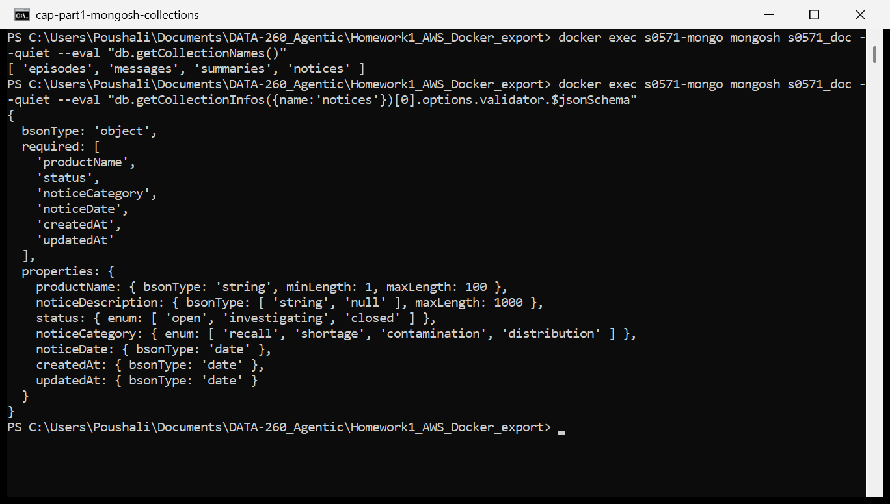

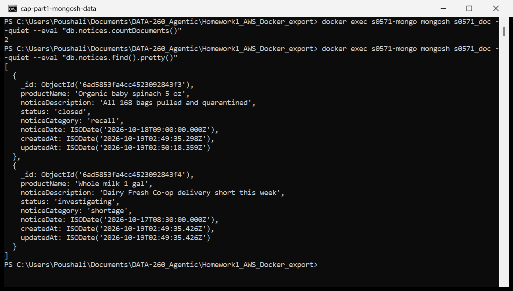

A document inserted straight through mongosh with `noticeCategory: 'rumor'` is rejected by the validator, so the rules hold even when the API is bypassed:

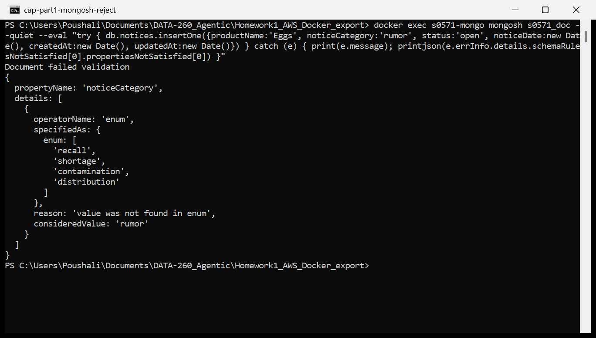

### II. API implementation

The code is split into `app.py` (FastAPI app, CORS middleware, routers, MongoDB error handlers), `config.py` (settings from `.env`), `mongo_db.py` (connection and validators), `doc_schemas.py` (Pydantic models) and `routers/doc_notices.py` (the five routes under `/api/doc/notices`). FastAPI parses the JSON body into the Pydantic model, so invalid data is answered with 422 before any database call; a malformed ObjectId gives 400, a missing document 404, a `PUT` without fields 400, a document that MongoDB's validator refuses 400 and any other PyMongo error 500.

```python
router = APIRouter(prefix="/api/doc/notices")

def to_object_id(notice_id: str) -> ObjectId:
    try:
        return ObjectId(notice_id)
    except InvalidId:
        raise HTTPException(status_code=400, detail="Invalid notice id")

def find_notice(notice_id: str) -> dict:
    doc = get_collection("notices").find_one({"_id": to_object_id(notice_id)})
    if doc is None:
        raise HTTPException(status_code=404, detail="Notice not found")
    return doc

@router.post("", response_model=NoticeDocOut, status_code=201)
def create_notice(data: NoticeDocIn):
    doc = data.model_dump()
    doc["createdAt"] = doc["updatedAt"] = now()
    result = get_collection("notices").insert_one(doc)
    return serialize(get_collection("notices").find_one({"_id": result.inserted_id}))

@router.get("", response_model=list[NoticeDocOut])
def list_notices():
    docs = get_collection("notices").find().sort("createdAt", -1)
    return [serialize(doc) for doc in docs]

@router.get("/{notice_id}", response_model=NoticeDocOut)
def get_notice(notice_id: str):
    return serialize(find_notice(notice_id))

@router.put("/{notice_id}", response_model=NoticeDocOut)
def update_notice(notice_id: str, data: NoticeDocUpdate):
    find_notice(notice_id)
    updates = data.model_dump(exclude_unset=True)
    if not updates:
        raise HTTPException(status_code=400, detail="No fields to update")
    updates["updatedAt"] = now()
    get_collection("notices").update_one({"_id": to_object_id(notice_id)}, {"$set": updates})
    return serialize(find_notice(notice_id))

@router.delete("/{notice_id}", status_code=204)
def delete_notice(notice_id: str):
    result = get_collection("notices").delete_one({"_id": to_object_id(notice_id)})
    if result.deleted_count == 0:
        raise HTTPException(status_code=404, detail="Notice not found")
```

```python
@app.exception_handler(WriteError)
def mongo_validation_error(request: Request, error: WriteError):
    return JSONResponse(status_code=400, content={"detail": f"MongoDB rejected the document: {error.details.get('errmsg')}"})

@app.exception_handler(PyMongoError)
def mongo_error(request: Request, error: PyMongoError):
    return JSONResponse(status_code=500, content={"detail": f"MongoDB error: {type(error).__name__}"})
```

Create (three documents, the second with an explicit status, the third without a description):

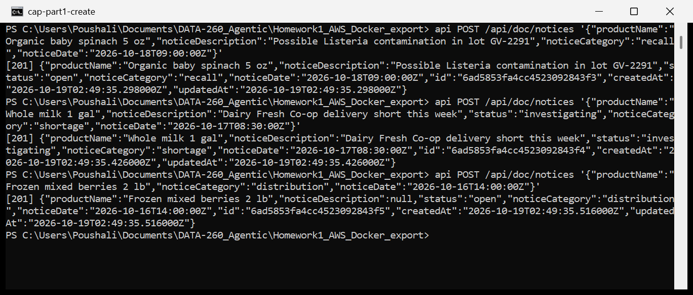

Retrieve all, retrieve one by id, unknown id (404) and malformed id (400):

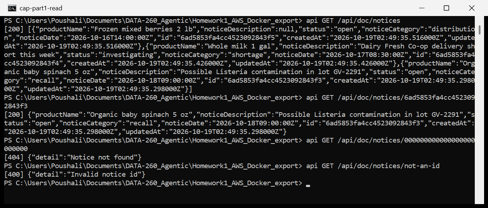

Update (partial `PUT`, `updatedAt` changes), empty update (400), delete (204), delete again and read after delete (404):

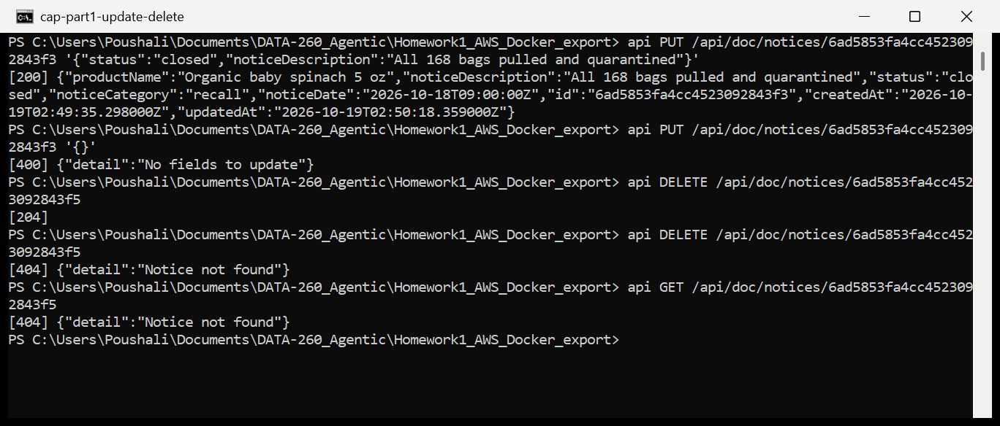

### III. Data validation

```python
Status = Literal["open", "investigating", "closed"]
Category = Literal["recall", "shortage", "contamination", "distribution"]

class NoticeDocIn(BaseModel):
    productName: str = Field(min_length=1, max_length=100)
    noticeDescription: str | None = Field(default=None, max_length=1000)
    status: Status = "open"
    noticeCategory: Category
    noticeDate: datetime

class NoticeDocUpdate(BaseModel):
    productName: str | None = Field(default=None, min_length=1, max_length=100)
    noticeDescription: str | None = Field(default=None, max_length=1000)
    status: Status | None = None
    noticeCategory: Category | None = None
    noticeDate: datetime | None = None
```

Missing required field, invalid enum value, wrong type for the date, wrong type for the status enum and a 120 character product name are all answered with 422 and the Pydantic error list that names the field, the problem and the input:

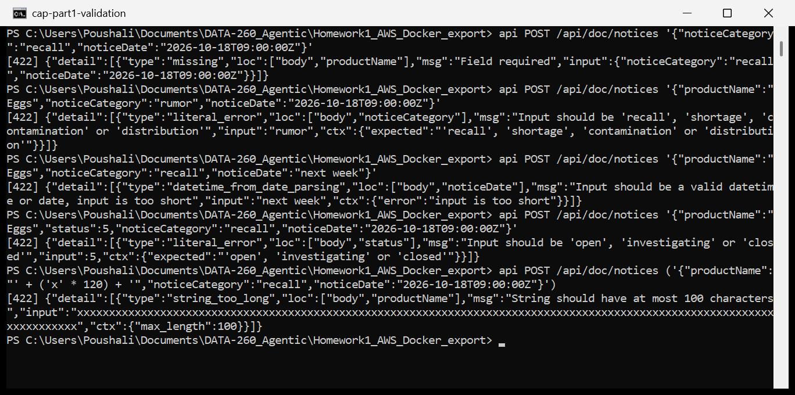

## Part 2: Short-, long- and episodic memory

### Collections

The same database `s0571_doc` gets `messages`, `summaries` and `episodes`, each with its own `$jsonSchema` validator in `mongo_db.py` (role enum `user`/`assistant`, scope enum `session`/`user`, `session_id` nullable only in `summaries`, `importance` a double between 0 and 1, `embedding` an array of doubles) and indexes on `user_id`, `session_id` and `created_at`. The `notices` collection from Part 1 is untouched.

```python
SUMMARY_SCHEMA = {
    "bsonType": "object",
    "required": ["user_id", "session_id", "scope", "text", "created_at"],
    "properties": {
        "user_id": {"bsonType": "string"},
        "session_id": {"bsonType": ["string", "null"]},
        "scope": {"enum": ["session", "user"]},
        "text": {"bsonType": "string"},
        "created_at": {"bsonType": "date"},
    },
}

EPISODE_SCHEMA = {
    "bsonType": "object",
    "required": ["user_id", "session_id", "fact", "importance", "embedding", "created_at"],
    "properties": {
        "user_id": {"bsonType": "string"},
        "session_id": {"bsonType": "string"},
        "fact": {"bsonType": "string", "maxLength": 200},
        "importance": {"bsonType": "double", "minimum": 0, "maximum": 1},
        "embedding": {"bsonType": "array", "items": {"bsonType": "double"}},
        "created_at": {"bsonType": "date"},
    },
}
```

### Endpoints (`routers/chat.py`)

`POST /api/chat` follows the required order: save the user message, load the short-term window (the last `SHORT_TERM_N` messages of the session, excluding the new one), load the latest session summary and lifetime summary, retrieve the top-k episodes, build the prompt, call `qwen3:8b` through the HW1 adapter `src/model_client.py`, save the reply, extract and embed up to three facts from the user message, and every `SUMMARIZE_EVERY_USER_MSGS` (5) user messages write a session summary; every second session summary is condensed into the lifetime summary. The request may override `short_term_n` and `policy` (used by the Part 3 sweep) and may set `file_memory` (Part 4). Messages that start with `/` are routed to the Part 4 commands.

```python
@router.post("/chat", response_model=ChatOut)
def chat(data: ChatIn):
    started = time.perf_counter()
    session_id = data.session_id or uuid.uuid4().hex[:12]
    if data.message.startswith("/"):
        result = handle_command(data.message, data.user_id, session_id)
        if result:
            return ChatOut(reply=result.pop("reply"), session_id=session_id, used={"command": result}, usage={})

    n = SHORT_TERM_N if data.short_term_n is None else data.short_term_n
    user_doc = memory.save_message(data.user_id, session_id, "user", data.message)
    window = memory.short_term_window(data.user_id, session_id, n, exclude_id=user_doc["_id"])
    if data.policy == "compress_old":
        window = memory.compress_old(window)
    session_summary = memory.latest_summary(data.user_id, "session", session_id)
    lifetime_summary = memory.latest_summary(data.user_id, "user")
    episodes = memory.retrieve_episodes(data.user_id, data.message)

    file_text = None
    consolidated = False
    if data.file_memory:
        if needs_consolidation(load_file(MEMORY_FILE)):
            consolidate()
            consolidated = True
        file_text = system_prompt_block()

    messages, parts = memory.build_prompt(session_summary, lifetime_summary, window, episodes, data.message, file_text)
    model_started = time.perf_counter()
    response = memory.chat_model.complete(messages)
    model_ms = round((time.perf_counter() - model_started) * 1000)
    memory.save_message(data.user_id, session_id, "assistant", response.text)

    facts, extraction = memory.extract_episodes(data.user_id, session_id, data.message)
    aux_calls = [extraction] + memory.maybe_summarize(data.user_id, session_id)

    usage = {
        "prompt_tokens": response.input_tokens,
        "completion_tokens": response.output_tokens,
        **memory.split_tokens(parts, response.input_tokens),
        "model_latency_ms": model_ms,
        "latency_ms": round((time.perf_counter() - started) * 1000),
        "aux_prompt_tokens": sum(r.input_tokens for r in aux_calls),
        "aux_completion_tokens": sum(r.output_tokens for r in aux_calls),
        "summaries_written": len(aux_calls) - 1,
    }
    memory.log_turn({"timestamp": datetime.now(timezone.utc).isoformat(timespec="seconds"), "user_id": data.user_id,
                     "session_id": session_id, "short_term_n": n, "policy": data.policy,
                     "file_memory": data.file_memory, **usage})
    used = {
        "short_term": {"count": len(window), "messages": window},
        "long_term": {"session_summary": session_summary, "lifetime_summary": lifetime_summary},
        "episodes": episodes,
        "new_facts": facts,
        "file_memory": {"included": data.file_memory, "consolidated": consolidated},
    }
    return ChatOut(reply=response.text, session_id=session_id, used=used, usage=usage)
```

```python
@router.get("/memory/{user_id}")
def get_memory(user_id: str):
    messages = list(get_collection("messages").find({"user_id": user_id}).sort("created_at", -1).limit(16))
    session = get_collection("summaries").find_one({"user_id": user_id, "scope": "session"}, sort=[("created_at", -1)])
    lifetime = get_collection("summaries").find_one({"user_id": user_id, "scope": "user"}, sort=[("created_at", -1)])
    episodes = list(get_collection("episodes").find({"user_id": user_id}).sort("created_at", -1).limit(20))
    return {
        "user_id": user_id,
        "messages": [clean(m) for m in reversed(messages)],
        "session_summary": clean(session) if session else None,
        "lifetime_summary": clean(lifetime) if lifetime else None,
        "episodes": [clean(e) for e in episodes],
    }

@router.get("/aggregate/{user_id}")
def aggregate(user_id: str):
    pipeline = [
        {"$match": {"user_id": user_id}},
        {"$group": {"_id": {"$dateToString": {"format": "%Y-%m-%d", "date": "$created_at"}}, "messages": {"$sum": 1}}},
        {"$sort": {"_id": 1}},
    ]
    daily = [{"date": row["_id"], "messages": row["messages"]} for row in get_collection("messages").aggregate(pipeline)]
    summaries = get_collection("summaries").find({"user_id": user_id}).sort("created_at", -1).limit(5)
    return {"user_id": user_id, "daily_message_counts": daily, "recent_summaries": [clean(s) for s in summaries]}
```

### Memory logic (`memory.py`)

Short-term window and the compression policy used in Part 3:

```python
def short_term_window(user_id, session_id, n, exclude_id=None):
    if n <= 0:
        return []
    query = {"user_id": user_id, "session_id": session_id}
    if exclude_id is not None:
        query["_id"] = {"$ne": exclude_id}
    docs = list(get_collection("messages").find(query).sort("created_at", -1).limit(n))
    return [{"role": d["role"], "content": d["content"]} for d in reversed(docs)]

def compress_old(window):
    recent = window[-KEEP_VERBATIM:]
    older = window[:-KEEP_VERBATIM] if len(window) > KEEP_VERBATIM else []
    compressed = []
    for message in older:
        text = message["content"]
        if len(text) > COMPRESSED_CHARS:
            text = text[:COMPRESSED_CHARS].rsplit(" ", 1)[0] + " ..."
        compressed.append({"role": message["role"], "content": text})
    return compressed + recent
```

Episode extraction (one structured-output call per user message, then MiniLM embeddings stored as a float array) and retrieval by cosine similarity:

```python
def extract_episodes(user_id, session_id, message):
    prompt = (
        "Extract up to 3 short facts about the user, their store, people, products, lots, codes or "
        "preferences from the message below. Skip questions and small talk. Return JSON of the form "
        '{"facts": [{"fact": "...", "importance": 0.0}]} where importance is between 0 and 1.\n\n'
        f"Message: {message}"
    )
    response = aux_model.complete([{"role": "user", "content": prompt}], response_format=schema)
    try:
        facts = json.loads(response.text).get("facts", [])
    except json.JSONDecodeError:
        facts = []
    facts = [f for f in facts if isinstance(f.get("fact"), str) and f["fact"].strip()][:MAX_FACTS_PER_MESSAGE]
    if facts:
        vectors = embed([f["fact"] for f in facts])
        docs = []
        for fact, vector in zip(facts, vectors):
            importance = min(1.0, max(0.0, float(fact.get("importance", 0.5))))
            docs.append({"user_id": user_id, "session_id": session_id, "fact": fact["fact"].strip()[:200],
                         "importance": importance, "embedding": vector, "created_at": now()})
        get_collection("episodes").insert_many(docs)
    return facts, response

def retrieve_episodes(user_id, message, k=TOP_K_EPISODES):
    docs = list(get_collection("episodes").find({"user_id": user_id}, {"fact": 1, "importance": 1, "embedding": 1}))
    if not docs or k <= 0:
        return []
    query = embed([message])[0]
    scored = [(cosine(query, d["embedding"]), d) for d in docs]
    scored.sort(key=lambda item: item[0], reverse=True)
    return [{"fact": d["fact"], "importance": d["importance"], "score": round(score, 3)} for score, d in scored[:k]]
```

Prompt assembly (system primer, lifetime and session summaries, episodic facts, then the window and the current message) and the summarization trigger:

```python
def build_prompt(session_summary, lifetime_summary, window, episodes, message, file_memory_text=None):
    parts = {"primer": PRIMER, "summary": "", "episodes": "", "window": "", "message": message, "file_memory": ""}
    system = PRIMER
    if file_memory_text:
        parts["file_memory"] = file_memory_text
        system += "\n\n" + file_memory_text
    long_term = ""
    if lifetime_summary:
        long_term += "What you know about this user from earlier sessions:\n" + lifetime_summary
    if session_summary:
        long_term += ("\n\n" if long_term else "") + "Summary of this session so far:\n" + session_summary
    if long_term:
        parts["summary"] = long_term
        system += "\n\n" + long_term
    if episodes:
        facts = "\n".join(f"- {e['fact']}" for e in episodes)
        parts["episodes"] = "Relevant facts from memory:\n" + facts
        system += "\n\n" + parts["episodes"]
    parts["window"] = "\n".join(f"{m['role']}: {m['content']}" for m in window)
    messages = [{"role": "system", "content": system}] + window + [{"role": "user", "content": message}]
    return messages, parts

def maybe_summarize(user_id, session_id):
    count = user_message_count(user_id, session_id)
    responses = []
    if count and count % SUMMARIZE_EVERY_USER_MSGS == 0:
        responses.append(summarize_session(user_id, session_id))
        session_summaries = get_collection("summaries").count_documents({"user_id": user_id, "scope": "session"})
        if session_summaries % LIFETIME_EVERY_SUMMARIES == 0:
            responses.append(condense_lifetime(user_id))
    return responses
```

`summarize_session` sends the previous session summary plus the last ten messages and stores the reply under `scope='session'`; `condense_lifetime` sends the previous profile plus the latest five session summaries and stores the reply under `scope='user'` with `session_id = null`.

### Run

Ten messages were sent in one session (`user_id` `poushali`, `session_id` `demo-1`) through the mini chat page at `/chat` (`chat.html`, one input box calling `POST /api/chat`; a Playwright script typed the messages). The right-hand panel shows the `used` object of the last turn: the 12-message short-term window, the session summary written after message 10, the four episodic facts retrieved for the question and the facts extracted from it. The tenth message asks for the lot code and the update preference from turns 2 and 6, and the reply gets both right (`raw/chat_page_session.json`).

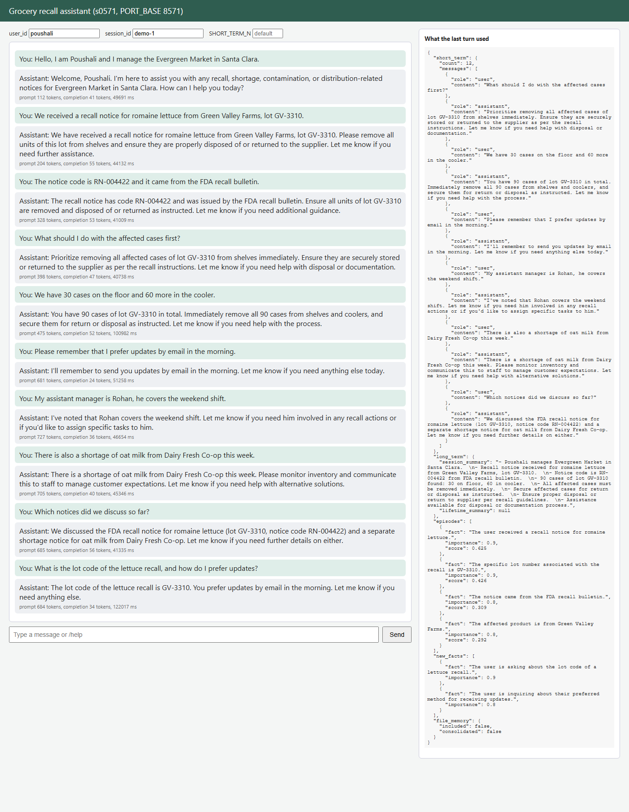

`GET /api/memory/poushali` returns the last 16 messages, the latest session summary, the latest lifetime summary and the last 20 episodic facts (full output in `raw/part2_api.txt`):

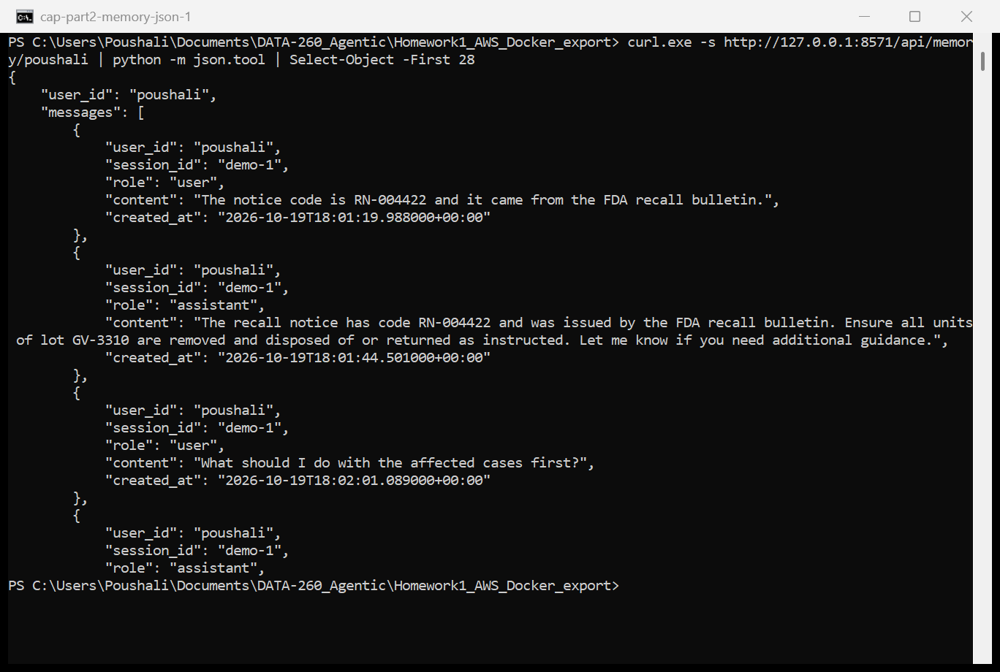

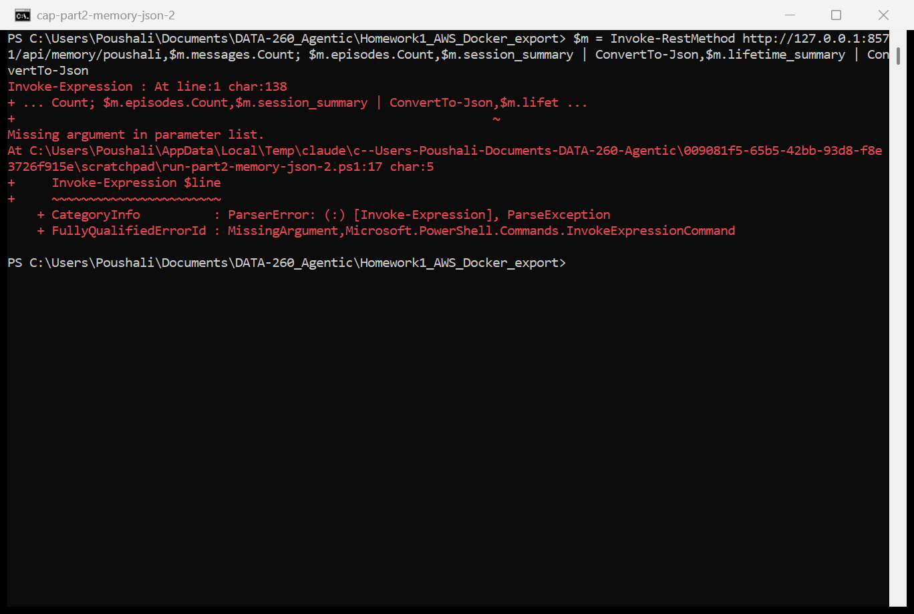

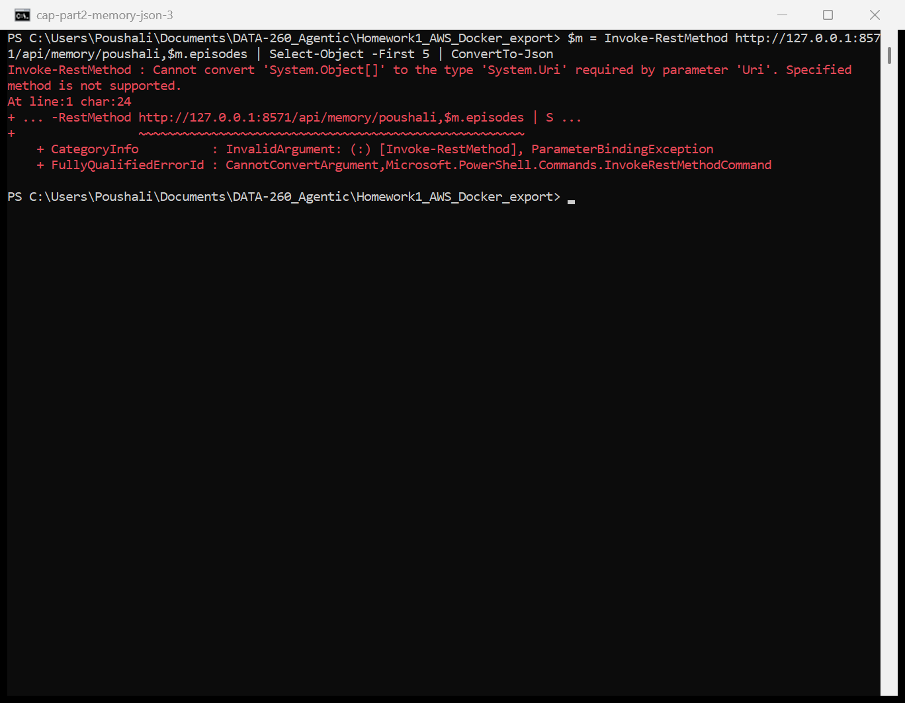

`GET /api/aggregate/poushali` groups the user's messages by day with `$group` on `$dateToString` and lists the most recent summaries:

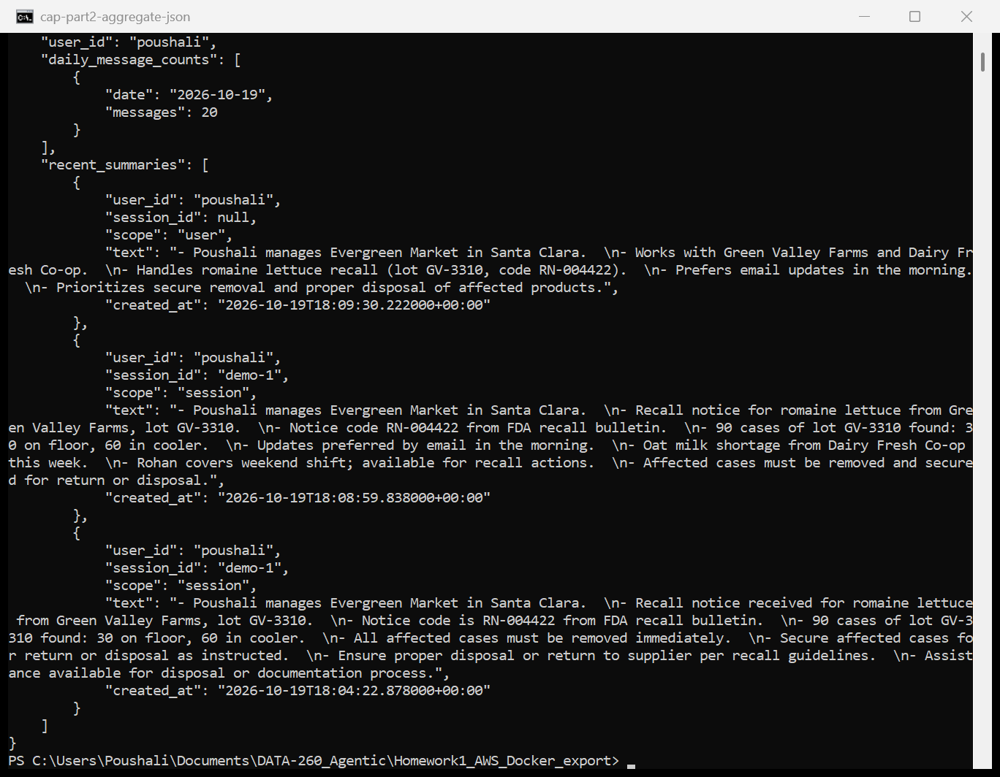

The three collections in mongosh (messages with role and timestamps, the two session summaries and the lifetime summary with `session_id: null`, episodes with importance and the embedding array, shown with `$slice: 4`):

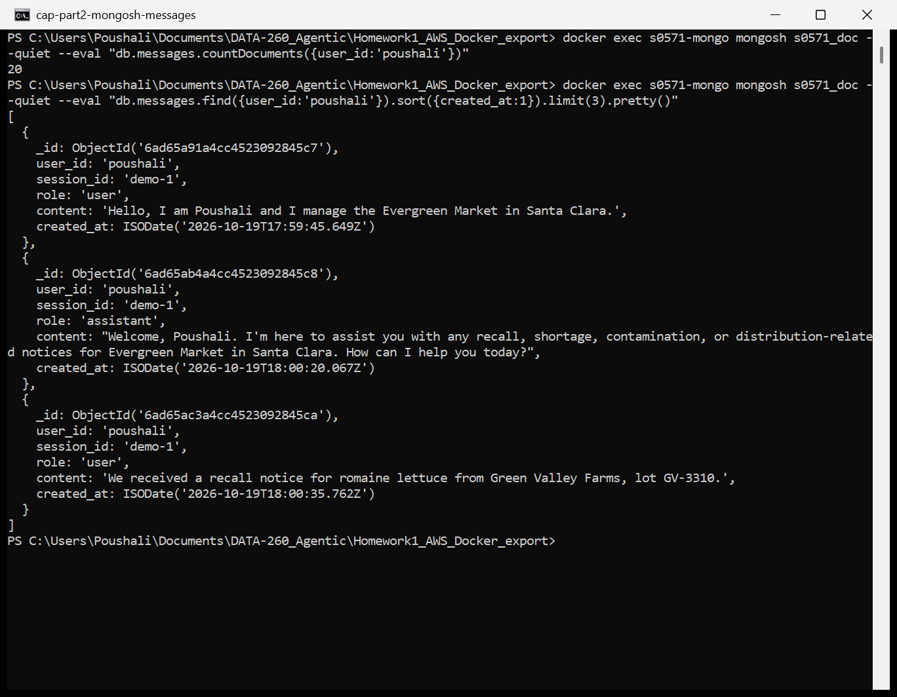

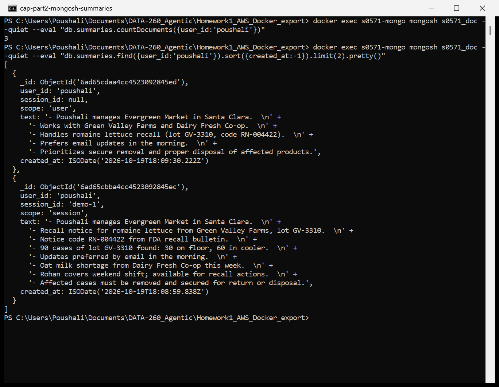

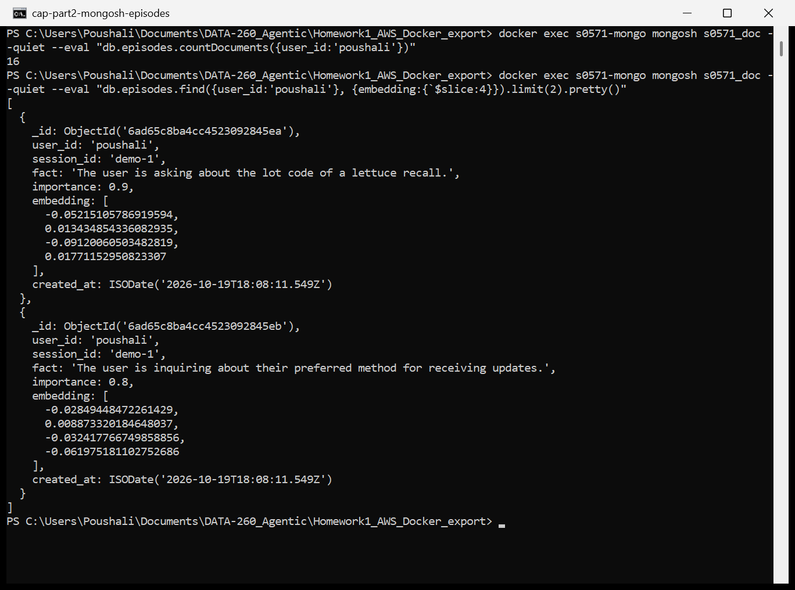

## Part 3: What memory costs

### 1. Logging memory usage

Every `POST /api/chat` records the prompt and completion tokens that Ollama reports, the request latency (whole request, including the fact-extraction call and any summary call after the reply), the chat-call latency, and the tokens of the system primer, the long-term summaries, the short-term window, the episodic facts and the current message. Ollama only gives the total prompt count, so the parts are the measured total split in proportion to the character count of each part. The rows go to `raw/chat_log.csv` (145 requests) and the `usage` object of the response.

```python
def split_tokens(parts, prompt_tokens):
    total_chars = sum(len(text) for text in parts.values()) or 1
    return {f"{name}_tokens": round(prompt_tokens * len(text) / total_chars) for name, text in parts.items()}

def log_turn(row):
    path = Path(CHAT_LOG)
    path.parent.mkdir(parents=True, exist_ok=True)
    new_file = not path.exists()
    with path.open("a", newline="", encoding="utf-8") as f:
        writer = csv.DictWriter(f, fieldnames=list(row))
        if new_file:
            writer.writeheader()
        writer.writerow(row)
```

```
timestamp,user_id,session_id,short_term_n,policy,file_memory,prompt_tokens,completion_tokens,primer_tokens,summary_tokens,episodes_tokens,window_tokens,message_tokens,file_memory_tokens,model_latency_ms,latency_ms,aux_prompt_tokens,aux_completion_tokens,summaries_written
2026-10-19T04:42:31+00:00,sweep_n30,n30-session,30,none,False,1401,35,90,227,79,992,13,0,72359,83933,99,40,0
2026-10-19T04:45:24+00:00,sweep_n30,n30-session,30,none,False,1399,70,90,227,83,991,9,0,102094,173066,630,181,1
```

### 2. Memory probes

`memory_probes.yaml` was written before the runs: five fixed questions about facts planted in turns 1, 2 to 3, 6, 12, 15 and 20 of the conversation, the expected items, and the rubric. The score is computed, not judged: an item counts when one of its phrases is in the reply and `score = 1 + round(4 * found / total)`.

```yaml
rubric:
  5: every expected item is in the reply
  4: about three quarters of the items are in the reply
  3: about half of the items are in the reply
  2: about a quarter of the items are in the reply
  1: nothing expected is in the reply, the assistant says it does not know, or it answers with other values
probes:
  - id: p1
    question: "Remind me, what is my name and which store do I manage?"
    expected:
      - ["Maya"]
      - ["Willow Glen"]
  - id: p2
    question: "Which lot code and which notice code did the spinach recall have?"
    expected:
      - ["GV-2291"]
      - ["RN-004410"]
  - id: p3
    question: "How do I prefer to receive follow-ups from you?"
    expected:
      - ["email", "e-mail"]
  - id: p4
    question: "Who is my assistant manager and which shift does he cover?"
    expected:
      - ["Daniel"]
      - ["night"]
  - id: p5
    question: "What is our store code, and how many spinach bags did we pull in total?"
    expected:
      - ["WG-17"]
      - ["168"]
```

### 3. Short-term memory sizes

`run_memory_cost.py` sends the same 30-message conversation (a store manager working through a spinach recall and a milk shortage) to a fresh user and session for each setting, overriding `short_term_n` and `policy` per request, then asks the five probes in the same session; `summarize_memory_cost.py` scores the probes and computes the means over the 30 conversation turns (`raw/sweep_turns.csv`, `raw/probe_scores.csv`, `raw/sweep_summary.json`). The sweep ran in resumable chunks over about four hours of model time on the CPU; the laptop slept once during the N=30 run, the unfinished turn was removed before resuming, and the run log records it.


| Setting | Mean prompt tokens/turn | Mean latency (ms) | Probe quality (1-5) |
|---|---|---|---|
| SHORT_TERM_N=4 | 483.4 | 58084 | 5.0 |
| SHORT_TERM_N=12 | 709.3 | 82279 | 5.0 |
| SHORT_TERM_N=30 | 1083.4 | 108547 | 5.0 |
| Eviction/compression policy (N=30, compress_old) | 900.0 | 82594 | 4.6 |

| Setting | Primer | Long-term summaries | Short-term window | Episodic facts | Chat call only (ms) | Completion tokens |
|---|---|---|---|---|---|---|
| N=4 | 92.1 | 184.9 | 131.0 | 61.0 | 25688 | 44.2 |
| N=12 | 91.6 | 174.8 | 367.9 | 60.5 | 47044 | 45.4 |
| N=30 | 92.2 | 175.4 | 740.5 | 61.0 | 77720 | 44.0 |
| N=30 + compress_old | 95.1 | 181.7 | 545.4 | 63.0 | 53899 | 42.4 |

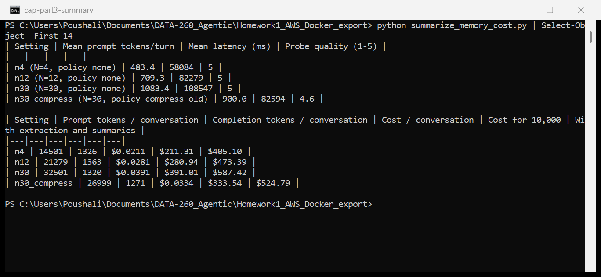

Only the window grows with N; the summaries and the four retrieved facts stay at about 240 tokens together. All three plain settings scored 5 on every probe: by the time the probes were asked the planted facts were outside even the 30-message window (15 turns), so in every setting they came from the session summary and the retrieved episodes. The larger window bought nothing on these probes and cost 2.2 times the prompt tokens and 1.9 times the latency of N=4.

### 4. One memory-saving policy

`compress_old` keeps the last 4 messages of the window verbatim and cuts every older message in the window to its first 100 characters (one line per message instead of a full reply). Applied to N=30 it saved 5,502 prompt tokens per conversation (16.9%, 183 tokens per turn) and 26 s of latency per turn. Probe quality dropped from 5.0 to 4.6: p5 was answered with "WG-037" instead of WG-17. In that run the session summary written at message 30 had dropped the store code, the four retrieved facts for the two-part question were the spinach-bag facts, and the turn-15 message was no longer in the window, so the model guessed a code. The other four probes were unaffected (`raw/probe_scores.csv`).

### 5. Memory cost estimate

Input $1 per million tokens, output $5 per million tokens, 10,000 conversations of 30 turns. "Chat calls" counts the 30 chat completions of a conversation; "with memory maintenance" adds the 30 fact-extraction calls and the 9 summary calls that the memory system makes per conversation.

| Setting | Prompt tokens / conversation | Completion tokens / conversation | Chat calls, per conversation | Chat calls, 10,000 conversations | With memory maintenance, 10,000 |
|---|---|---|---|---|---|
| N=4 (best) | 14,501 | 1,326 | $0.0211 | $211.31 | $405.10 |
| N=12 | 21,279 | 1,363 | $0.0281 | $280.94 | $473.39 |
| N=30 (worst) | 32,501 | 1,320 | $0.0391 | $391.01 | $587.42 |
| N=30 + compress_old | 26,999 | 1,271 | $0.0334 | $333.54 | $524.79 |

How the best and worst settings were chosen: the worst setting is the one with the highest chat cost, N=30. The best setting is the cheapest among those whose probe quality is within 0.5 of the highest score; all four qualify, so the best is N=4 (`summarize_memory_cost.py` applies this rule and writes it to `raw/sweep_summary.json`). For the same probe quality the worst setting costs 1.85 times the best. The maintenance calls are a fixed $194 per 10,000 conversations in every setting; they are what lets the 4-message window keep the facts, so the real saving of a small window is the window itself, about $180 per 10,000 conversations between N=4 and N=30.

## Part 4: File-based memory and consolidation

### 1 and 2. Memory files and the file-based memory functions

`AGENT.md` (reused from HW1 and expanded, final version below) holds the durable project and agent instructions; `MEMORY.md` holds durable facts as bullet lines under a header with the last consolidation time stored as an HTML comment. `file_memory.py` loads both files, builds the block that goes into the system prompt, reads the timestamp and decides when consolidation is needed (more than 40 fact lines, or a stamp older than 24 hours or missing). `POST /api/chat` with `file_memory: true` runs the check, consolidates first if needed, and then adds the block to the system prompt in `build_prompt`.

```python
STAMP = re.compile(r"<!--\s*last_consolidated:\s*(\S+)\s*-->")

def load_file(name):
    path = Path(name)
    return path.read_text(encoding="utf-8") if path.exists() else ""

def fact_lines(text):
    return [line for line in text.splitlines() if line.strip() and not line.strip().startswith(("#", "<!--"))]

def read_last_consolidated(text):
    match = STAMP.search(text)
    return datetime.fromisoformat(match.group(1)) if match else None

def needs_consolidation(text):
    stamp = read_last_consolidated(text)
    too_long = len(fact_lines(text)) > MEMORY_MAX_LINES
    too_old = stamp is None or datetime.now(timezone.utc) - stamp > timedelta(hours=MEMORY_MAX_AGE_HOURS)
    return too_long or too_old

def system_prompt_block():
    return (
        "Project instructions (AGENT.md):\n" + load_file(AGENT_FILE).strip()
        + "\n\nDurable facts from earlier conversations (MEMORY.md):\n" + "\n".join(fact_lines(load_file(MEMORY_FILE)))
    )
```

```python
    if data.file_memory:
        if needs_consolidation(load_file(MEMORY_FILE)):
            consolidate()
            consolidated = True
        file_text = system_prompt_block()
    messages, parts = memory.build_prompt(session_summary, lifetime_summary, window, episodes, data.message, file_text)
```

### 3. Memory commands

Commands are sent as the message of `POST /api/chat` and handled before any model call for the chat itself. `/compact` numbers the fact lines and asks the model only for index groups, as schema-constrained JSON: `duplicates` (facts that say the same thing), `related` (facts about the same person, product or topic) and `conflicts` (pairs with `keep`, `drop` and a reason). The code then rebuilds the file, conflicts first so that a contradicting pair is never swallowed by a topic group: a duplicate group keeps its longest line, but only if the lines really overlap (word-set similarity of at least 0.5), otherwise the lines are joined instead of dropped; a related group is joined into one line with semicolons (at most six facts per line) so nothing is lost; a conflict becomes one `Resolved:` line that quotes the kept text, the dropped text and the reason; every line the model did not mention is kept unchanged and counted in `kept_unchanged`. A fact can therefore only leave the file through an explicit merge or an explicit resolution. `/dream` asks the model for durable facts in the last 20 messages of the session and appends the new ones to `MEMORY.md`.

```python
def plain(line):
    return line[2:].strip() if line.startswith("- ") else line.strip()


def words(line):
    return {w.rstrip("sd") for w in re.findall(r"[a-z0-9]+", re.sub(r"\(noted [^)]*\)", "", plain(line).lower())) if len(w) > 2}


def similar(a, b):
    wa, wb = words(a), words(b)
    return len(wa & wb) / len(wa | wb) if wa | wb else 0.0


def consolidate():
    text = load_file(MEMORY_FILE)
    before = fact_lines(text)
    numbered = "\n".join(f"{i}. {plain(line)}" for i, line in enumerate(before, start=1))
    prompt = (
        "Below are numbered facts from the memory file of a grocery recall assistant. Return JSON with:\n"
        "'duplicates': groups of numbers whose facts say the same thing;\n"
        "'related': groups of numbers whose facts are about the same person, product or topic and can be "
        "written on one line;\n"
        "'conflicts': pairs of facts that contradict each other, as objects with 'keep', 'drop' and a short "
        "'reason' (prefer the later noted date or the more specific statement).\n"
        "A number may appear in at most one group or pair. Facts that stand alone are not listed.\n\n" + numbered
    )
    response = consolidation_model.complete([{"role": "user", "content": prompt}], response_format=CONSOLIDATION_SCHEMA)
    try:
        result = json.loads(response.text)
    except json.JSONDecodeError:
        result = {"duplicates": [], "related": [], "conflicts": []}
    valid = lambda i: isinstance(i, int) and 1 <= i <= len(before)
    used = set()
    output = []

    def take(group):
        group = [i for i in group if valid(i) and i not in used]
        used.update(group)
        return group

    resolved = []
    for item in result.get("conflicts", []):
        pair = take([item.get("keep"), item.get("drop")])
        if len(pair) != 2:
            used.difference_update(pair)
            continue
        line = (f"- Resolved: kept '{plain(before[pair[0] - 1])}'; dropped '{plain(before[pair[1] - 1])}' "
                f"({item.get('reason', '').strip()})")
        resolved.append(line)
        output.append((pair[0], line))
    for group in result.get("duplicates", []):
        group = take(group)
        if not group:
            continue
        first = before[group[0] - 1]
        if all(similar(first, before[i - 1]) >= 0.5 for i in group):
            output.append((group[0], max((before[i - 1] for i in group), key=len)))
        else:
            output.append((group[0], "- " + "; ".join(plain(before[i - 1]).rstrip(".") for i in group) + "."))
    for group in result.get("related", []):
        group = take(group)
        for start in range(0, len(group), 6):
            chunk = group[start:start + 6]
            output.append((chunk[0], "- " + "; ".join(plain(before[i - 1]).rstrip(".") for i in chunk) + "."))
    unassigned = [before[i - 1] for i in range(1, len(before) + 1) if i not in used]
    output += [(i, before[i - 1]) for i in range(1, len(before) + 1) if i not in used]
    after = [line for _, line in sorted(output, key=lambda item: item[0])]
    write_memory(after, datetime.now(timezone.utc))
    return {"lines_before": len(before), "lines_after": len(after), "resolved": resolved,
            "kept_unchanged": len(unassigned), "model_groups": result}
```

```python
def dream(user_id, session_id):
    recent = short_term_window(user_id, session_id, 20)
    if not recent:
        return []
    transcript = "\n".join(f"{m['role']}: {m['content']}" for m in recent)
    prompt = (
        "From the conversation below, list the facts worth remembering in future sessions: who the user is, "
        "their store, people, suppliers, codes and standing preferences. Skip questions and one-off chatter. "
        "Return at most 5 bullet lines starting with '- ', or the single word NONE.\n\n" + transcript
    )
    response = aux_model.complete([{"role": "user", "content": prompt}])
    text = load_file(MEMORY_FILE)
    existing = set(fact_lines(text))
    added = [line for line in bullets(response.text) if line not in existing]
    if added:
        stamp = read_last_consolidated(text) or datetime.now(timezone.utc)
        write_memory(fact_lines(text) + added, stamp)
    return added


def handle_command(message, user_id, session_id):
    command = message.strip().split()[0].lower()
    if command == "/help":
        return {"command": "help", "reply": HELP}
    if command == "/memory":
        text = load_file(MEMORY_FILE)
        stamp = read_last_consolidated(text)
        return {"command": "memory", "reply": system_prompt_block(), "fact_lines": len(fact_lines(text)),
                "last_consolidated": stamp.isoformat() if stamp else None, "needs_consolidation": needs_consolidation(text)}
    if command == "/compact":
        result = consolidate()
        reply = f"MEMORY.md consolidated: {result['lines_before']} lines before, {result['lines_after']} lines after."
        return {"command": "compact", "reply": reply, **result}
    if command == "/dream":
        added = dream(user_id, session_id)
        reply = ("Added to MEMORY.md:\n" + "\n".join(added)) if added else "Nothing new worth remembering."
        return {"command": "dream", "reply": reply, "added": added}
    return None
```

`/help` and `/memory` (the latter shows the counts, the stamp and the block that goes into the prompt; the original file had 53 fact lines and a stamp of 2026-10-10, so both consolidation triggers were true):

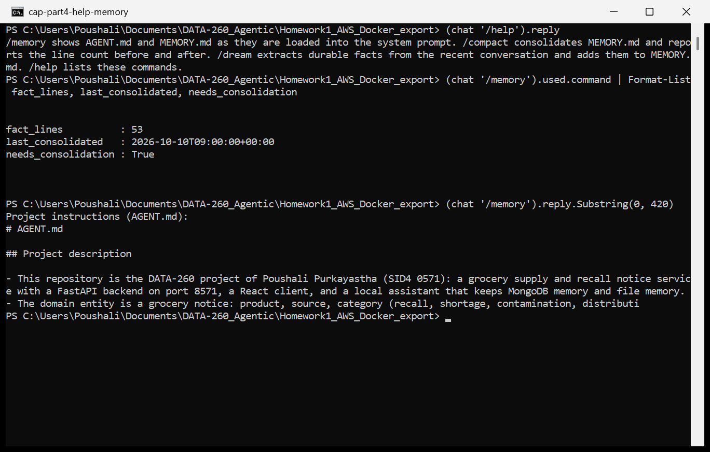

### 5. Consolidation test

The test file `MEMORY.md` (55 lines: header, stamp and 53 fact lines, committed as the original version and kept as `raw/MEMORY_original.md`) contains six duplicated lines (the user and store line, the store code, the email preference, Daniel's shift, Luis as produce contact, the loyalty card line) and five contradicting pairs: the delivery date of lot GV-2291 (October 12, noted 10-13, versus October 14, noted 10-16), the paperwork retention (two years, noted 10-05, versus five years, noted 10-16), the contact preference (email, noted 10-03, versus phone after 6 pm, noted 10-15), the contamination (E. coli, noted 10-13, versus Listeria, noted 10-16) and the store code (WG-17 versus WG-71 from the district report, no dates).

It took three attempts to get a consolidation that follows the rules; the earlier outputs are kept in `raw/` because they are the reason for the final design. The first `/compact` (one free-text rewrite, 220-token completion limit) returned 14 lines that stopped in the middle of a sentence and reported success (`raw/MEMORY_consolidated_attempt1.md`). The second (900-token limit) returned 48 lines with one `Resolved:` line and silently dropped the October 12 date and the two-year rule (`raw/MEMORY_consolidated_attempt2.md`). A third design that asked for rewritten lines with source numbers overran 1,800 tokens of JSON. The final design asks only for index groups and lets the code rebuild the file, so nothing can disappear without a trace.

`/compact` with the final design: 53 fact lines before, 24 after (27 lines in the file, `raw/MEMORY_consolidated.md`, committed as the consolidated version), five `Resolved:` lines, one line that the model did not mention and that was kept unchanged.

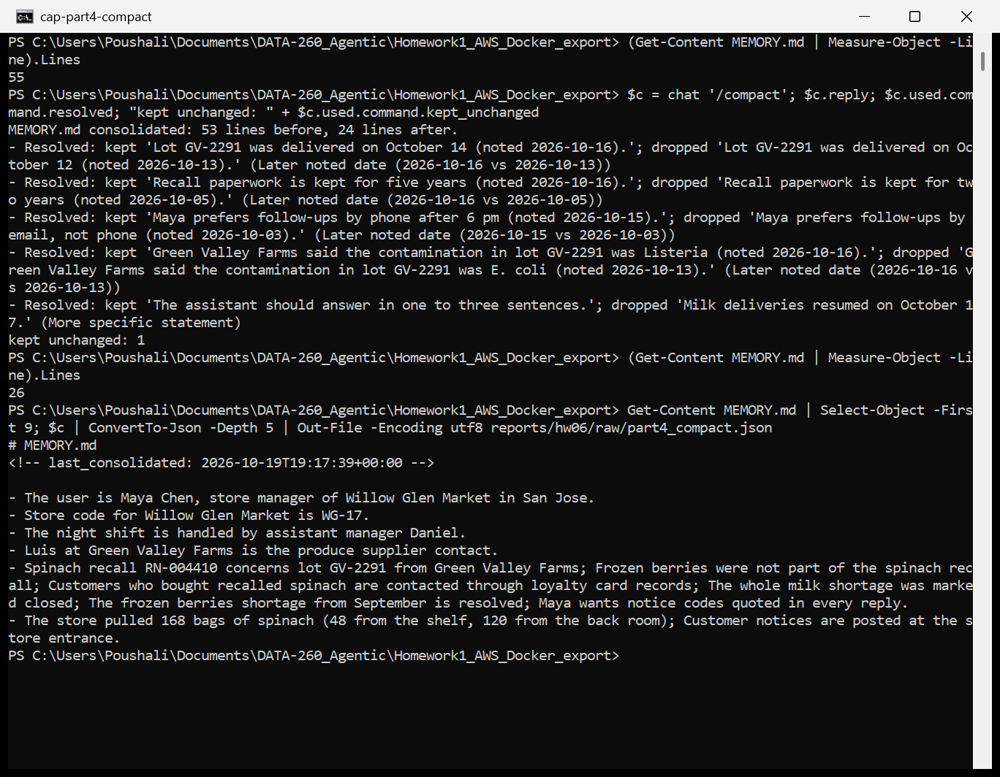

```
MEMORY.md consolidated: 53 lines before, 24 lines after.
- Resolved: kept 'Lot GV-2291 was delivered on October 14 (noted 2026-10-16).'; dropped 'Lot GV-2291 was delivered on October 12 (noted 2026-10-13).' (Later noted date (2026-10-16 vs 2026-10-13))
- Resolved: kept 'Recall paperwork is kept for five years (noted 2026-10-16).'; dropped 'Recall paperwork is kept for two years (noted 2026-10-05).' (Later noted date (2026-10-16 vs 2026-10-05))
- Resolved: kept 'Maya prefers follow-ups by phone after 6 pm (noted 2026-10-15).'; dropped 'Maya prefers follow-ups by email, not phone (noted 2026-10-03).' (Later noted date (2026-10-15 vs 2026-10-03))
- Resolved: kept 'Green Valley Farms said the contamination in lot GV-2291 was Listeria (noted 2026-10-16).'; dropped 'Green Valley Farms said the contamination in lot GV-2291 was E. coli (noted 2026-10-13).' (Later noted date (2026-10-16 vs 2026-10-13))
- Resolved: kept 'The assistant should answer in one to three sentences.'; dropped 'Milk deliveries resumed on October 17.' (More specific statement)
kept unchanged: 1
```

What the consolidation did, checked line by line against the original:

- Merged duplicates: all six duplicate pairs became one line each; the longer wording was kept (for example "The user is Maya Chen, store manager of Willow Glen Market in San Jose" absorbed "Maya manages Willow Glen Market in San Jose").
- Joined related facts: twelve topic groups were written as one line each with semicolons (milk supply and shortage, Priya and her monthly count, store hours and staff, the quarantine and disposal procedure), with no text removed.
- Resolved correctly: three dated contradictions were settled by the later note, which is the rule the file follows: October 14 instead of October 12, five years instead of two, Listeria instead of E. coli. Each `Resolved:` line quotes both versions and the reason.
- Resolved incorrectly (two): the contact preference was treated as a contradiction and "email, not phone (noted 10-03)" was dropped in favour of "phone after 6 pm (noted 10-15)", although the second line only adds an evening rule and the undated duplicate of the email line survived as its own line, so the file now states both; and the pair "The assistant should answer in one to three sentences" versus "Milk deliveries resumed on October 17" was declared a conflict with the reason "more specific statement" although the two facts have nothing to do with each other. Because both versions are quoted in the `Resolved:` line, the milk delivery date is still in the file and the mistake is visible; nothing was lost silently.
- Not detected: the store code contradiction (WG-17 versus WG-71) has no dates and the model did not pair the two lines, so both remain in the file as they were.

`/dream` after the ten-message chat session added five lines from the conversation (user, store, lot, notice code, preference) to the consolidated file, and a chat turn with `file_memory: true` in a new session (`demo-2`, question "What is our store code, and who handles the night shift?") answered "The store code is WG-17, and the night shift is handled by assistant manager Daniel" from the file block alone: 1,364 of the 1,621 prompt tokens were the AGENT.md and MEMORY.md block, `used.file_memory.included` is true and no consolidation was needed because the stamp was fresh and the file was under 40 lines. The answer picked WG-17 although the unresolved WG-71 line is also in the file.

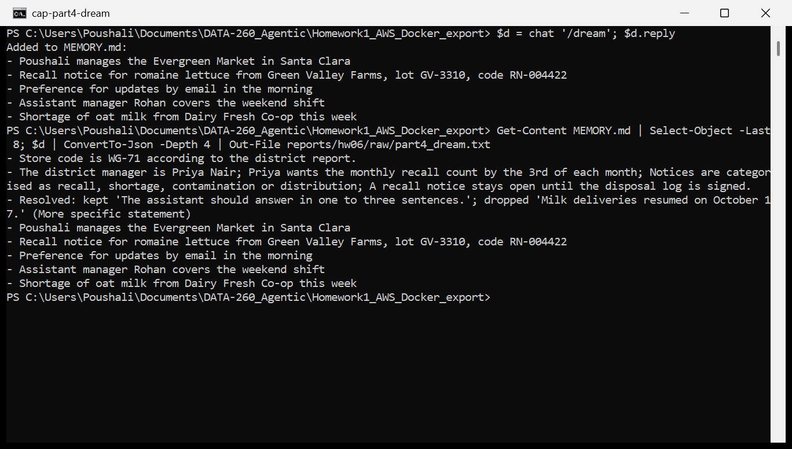

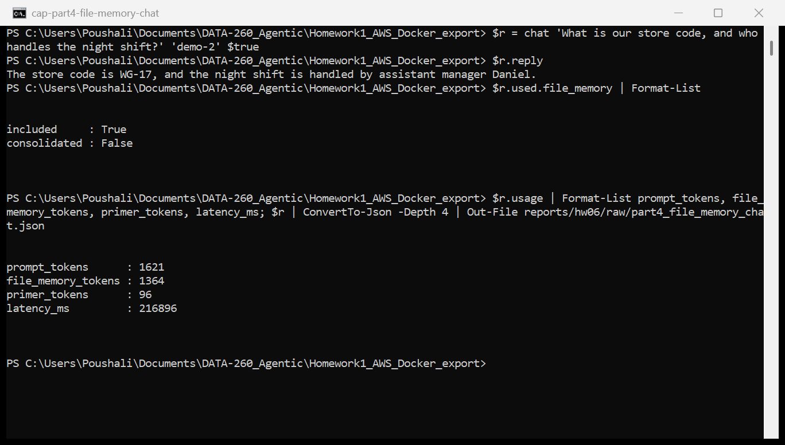

### 4. AGENT.md and the generated function

Final `AGENT.md` (the HW1 review rule is kept as the last section; 13 instructions under six headings, covering project description, technology stack, coding conventions, testing approach and prohibited actions):

```
# AGENT.md

## Project description

- This repository is the DATA-260 project of Poushali Purkayastha (SID4 0571): a grocery supply and recall notice service with a FastAPI backend on port 8571, a React client, and a local assistant that keeps MongoDB memory and file memory.
- The domain entity is a grocery notice: product, source, category (recall, shortage, contamination, distribution), status and dates.

## Technology stack

- Python 3.12 with FastAPI and Pydantic v2. MySQL through SQLAlchemy holds the relational data, MongoDB through PyMongo holds the document view and the chat memory.
- The language model is qwen3:8b served by Ollama and is called only through `src/model_client.py`.

## Coding conventions

- Functions use snake_case names, a type hint on every parameter and on the return value, and start with a one-line docstring.
- Library code returns values and raises ValueError on bad input. It never prints and never exits the process.
- Keep functions short and plain. No decorative comments and no code that is not used.

## Testing approach

- Every new function comes with at least one `test_` function that uses plain assert statements and runs with `python file.py`, without a test framework.
- Smoke tests live in `verify_hwNN.py`, write `reports/hwNN/verification.json`, and must not modify application code.

## Prohibited actions

- Never commit `.env`, API keys or passwords.
- Never drop MongoDB collections or MySQL tables from application code.
- Never call the model outside `src/model_client.py` and never use a paid hosted model for the homework runs.

## Code review output

- When asked to review code, return bullet-only feedback: every line begins with `- `, include only actionable findings or `- No issues found.`, and do not use headings, paragraphs, fenced code or greetings.
```

`agent_md_check.py` sends AGENT.md as the system prompt and asks for `notice_age_days(notice_date, today)`, saves the answer as `raw/generated_function.py` and checks it with `ast` against the conventions: the function exists, names are snake_case, every parameter and the return value are annotated, a docstring is present, there is no `print`, bad input raises `ValueError`, a `test_` function with `assert` exists, and the tests pass when run.

```python
def check_rules(code):
    tree = ast.parse(code)
    functions = [node for node in ast.walk(tree) if isinstance(node, ast.FunctionDef)]
    main = [f for f in functions if not f.name.startswith("test_")]
    tests = [f for f in functions if f.name.startswith("test_")]
    calls = [node for node in ast.walk(tree) if isinstance(node, ast.Call)]
    raises = [node for node in ast.walk(tree) if isinstance(node, ast.Raise)]
    return {
        "function_notice_age_days_exists": any(f.name == "notice_age_days" for f in functions),
        "snake_case_names": all(SNAKE.match(f.name) for f in functions),
        "type_hints_on_parameters_and_return": all(
            f.returns is not None and all(arg.annotation is not None for arg in f.args.args) for f in main),
        "docstring_present": all(ast.get_docstring(f) for f in main),
        "no_print_calls": not any(isinstance(c.func, ast.Name) and c.func.id == "print" for c in calls),
        "raises_value_error": any("ValueError" in ast.dump(r) for r in raises),
        "test_function_with_assert": any(any(isinstance(n, ast.Assert) for n in ast.walk(t)) for t in tests),
    }
```

Result: the model returned `notice_age_days` with type hints, a docstring, a `ValueError` on bad input, no print and a `test_notice_age_days` with five asserts; all eight checks passed and the tests ran without error (`raw/agent_md_check.json`).

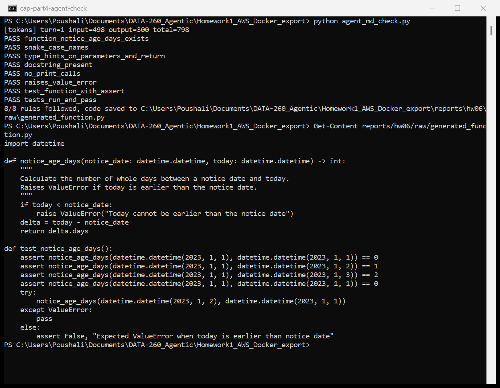

### 6. MongoDB memory and file-based memory compared

| Aspect | MongoDB memory (messages, summaries, episodes) | File memory (AGENT.md, MEMORY.md) |
|---|---|---|
| Inspectability | Needs a tool: mongosh, Compass or the `/api/memory` and `/api/aggregate` endpoints. Embeddings are 384 floats per fact and unreadable, but every message and summary carries `user_id`, `session_id` and `created_at`, so the exact prompt of any turn can be rebuilt, counted and aggregated with a query. | Two plain Markdown files that anyone can open, diff in Git and edit by hand; `/memory` shows exactly what goes into the prompt. Nothing records which conversation a line came from, and once `/compact` rewrites the file the history exists only in Git. |
| Persistence after a restart | Kept by the database in the Docker volume `s0571_mongo_data`; the API process holds no memory state, so a restart of `app.py` changes nothing (the Part 3 users were still complete after the server restart during this homework). The data is lost only if the volume is removed. | Kept on disk in the repository and versioned with every commit. A restart changes nothing, and the files survive even a loss of the database. |
| Scalability across many sessions | Scales: documents are keyed by user and session, indexes serve the window and summary lookups, and only a bounded part (N messages, two summaries, k facts) enters the prompt. The pure-Python cosine scan over all of a user's episodes is the first thing to replace with a vector index when a user has thousands of facts. | Does not scale: there is one MEMORY.md for everybody, the whole file goes into every prompt, and the 40-line limit forces a lossy consolidation after a few sessions. Separate users or sessions would need separate files and a loader that picks them. |
| Facts that must not be forgotten | Episodic facts are never deleted and are retrieved only when they look similar to the current message, so an important fact can miss retrieval; summaries are rewritten by the model every five messages and can drop or distort a detail (the model's wording of a fact changes between summaries). | Suited for a small number of rules and facts that must always be present, because the file is loaded unconditionally and a human can pin a line. The risk is consolidation: a model rewrite can merge or resolve a line wrongly, which is why the resolved lines are kept explicit and both versions are committed. |

For this project the two systems complement each other: AGENT.md and a short MEMORY.md carry the rules and the handful of standing facts, MongoDB carries the conversation history, the per-session summaries and the searchable fact store.

## Verification

`python verify_hw06.py` (`make verify-hw06`) ran on the tagged commit against the running server: health on PORT_BASE, the document CRUD round trip with the 422, 400 and 404 cases, a direct MongoDB insert that the validator must reject, one chat turn for a temporary user with the `used` and `usage` objects, the memory and aggregate endpoints, the `/help` and `/memory` commands, and the file checks (AGENT.md rules, MEMORY.md under 40 lines against the 53-line original, the four settings of 30 turns and 5 probes in the sweep file, the cost summary, the generated function and the report files). The temporary user's documents are deleted afterwards and no application code is touched. 21 of 21 checks passed; the output is `verification.json` and the console is in `RUN_LOG.txt`.

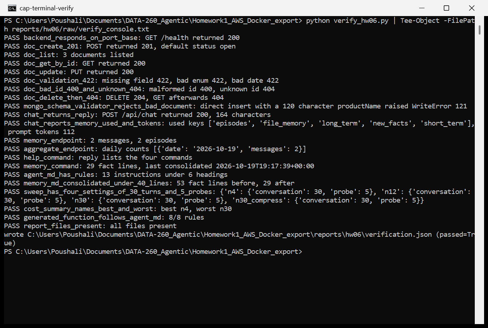

## AI use

1. I used an AI assistant for debugging and for preparing the report document
   (`report.md` / `report.pdf`). The debugging help covered the `collMod` call that
   re-applies a `$jsonSchema` validator to a collection that already exists, the
   `tz_aware` MongoClient option so that dates read back from MongoDB serialize with a
   time zone, the Ollama structured-output call (`format` with a JSON schema) behind the
   fact extraction and the consolidation, the slow first import of sentence-transformers
   inside the FastAPI process, and the PowerShell console capture used for the terminal
   screenshots. I designed the notice document and the three memory collections, wrote
   the routers, the memory logic, the file-memory commands, the probe file, the sweep
   and scoring scripts and the smoke test myself, ran every experiment on my laptop,
   reviewed the outputs and made the Canvas submission.

2. One model output that was wrong: the first `/compact` run on the 55-line MEMORY.md
   returned a file of 14 lines that ended in the middle of a sentence ("Recall paperwork
   is kept"), with no `Resolved:` line at all, and the command still reported "53 lines
   before, 14 lines after" as if it had succeeded (`raw/MEMORY_consolidated_attempt1.md`,
   `raw/part4_compact_attempt1.json`). The second run, with a larger output limit, gave
   48 lines: it merged three duplicates, wrote one explicit resolution (Listeria versus
   E. coli) and silently dropped the two other dated contradictions, the October 12
   delivery date and the two-year paperwork rule, while keeping both store codes and both
   contact preferences (`raw/MEMORY_consolidated_attempt2.md`).

3. I noticed the first problem by reading the consolidated file and comparing its length
   with the 220-token completion limit of the summary model client, which cut the answer
   off; the server log showed the output count at the limit. The second problem showed up
   when I diffed the original and the consolidated file line by line: facts had vanished
   without a `Resolved:` entry, which is exactly what the assignment forbids, and the
   count was still above 40.

4. I changed the consolidation so that the model no longer rewrites the file. A first
   rewrite with source numbers and a schema still ran into the output limit (the model
   produced 1,800 tokens of JSON and the code, finding nothing usable, kept all 53 lines,
   `raw/part4_compact_attempt3.json`). The final version asks the model only for index
   groups: duplicates, related facts and conflicting pairs with a reason, which is a few
   hundred tokens. The code then keeps the longest line of a duplicate group (and only if
   the lines really overlap), joins related facts into one line, writes one `Resolved:`
   line per conflict with both texts and the reason, and keeps every unmentioned line
   unchanged. A fact can now only leave the file through an explicit merge or an explicit
   resolution, the server runs with `OLLAMA_TIMEOUT=900` because the calls take minutes
   on this CPU, and the resulting counts and the resolutions I judged wrong are in the
   report and in `METRICS.md`.
