# DATA-260 Homework 8: Kafka Request/Response, Three-Agent Pipeline and Failure Behavior

**Poushali Purkayastha**

**GitHub repository:** https://github.com/Poushali0202/data260-0571 (collaborators Sbnikitha and supriyaselvanganesan have access)

## Section 0: Configuration

| Value | Result |
|---|---|
| SID4 | 0571 |
| PORT_BASE | 8000 + (571 mod 900) = 8571 |
| PREFIX | s0571 |
| SEED | 571 |
| VERIFY_SEED | 260000 + 571 = 260571 |
| DOMAIN_ID | 571 mod 8 = 3 (grocery supply and recall notices, entity GroceryNotice) |
| Hardware | Intel Core i5-1135G7, 15.8 GB RAM, Windows 11 Home, CPU only |
| Local model | qwen3:8b through Ollama 0.40.12, temperature 0 |
| Kafka | apache/kafka:3.9.2 in Docker (KRaft, one broker), Python client aiokafka 0.15.0 |
| Tagged commit | hw8 = 0f1ed5518ccaa77b85b6997c1283625fd1600d1e |

New code at the repository root: `notice_service/` (worker, FastAPI wrapper, Dockerfile), `homework_demo.py`, `kafka_common.py`, `planner.py`, `writer.py`, `reviewer.py`, `send_question.py`, `replay_task.py`, `send_poison.py`, `order_test.py`, `verify_hw08.py`. Kafka, the worker and the API were added to the existing `docker-compose.yml`.

All seven topics were created with the Kafka CLI before any run (`s0571_tasks` has two partitions, the rest one).

**Screenshot 0. Topic creation with kafka-topics.sh**

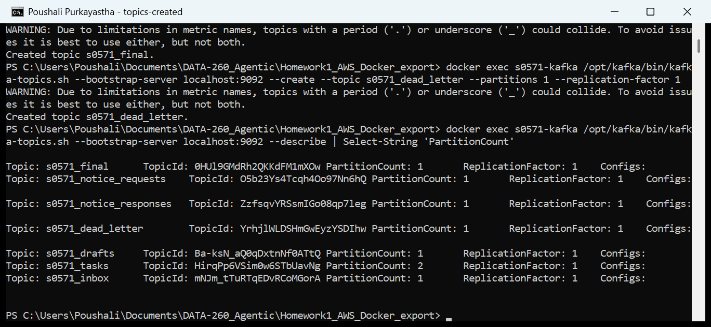

## Part 1: Backend Service Request/Response over Kafka

### I. Operations and naming

My primary entity is a grocery notice, so ENTITY becomes NOTICE: the operations are `CREATE_NOTICE` and `GET_NOTICE`, the id is `notice_id`, and the two topics are `s0571_notice_requests` and `s0571_notice_responses`. A notice needs `productName`, `noticeCode` (RN- plus six digits), `noticeSource`, `noticeCategory` (recall, shortage, contamination or distribution) and `affectedUnits` (whole number 0 or more). The worker keeps notices in a plain Python dict and creates `notice_id` with `uuid.uuid4()`.

### II. Message schemas

```
Request on s0571_notice_requests
{"correlation_id": "<uuid made by the client>", "reply_to": "s0571_notice_responses",
 "operation": "CREATE_NOTICE", "data": {"productName": "...", "noticeCode": "RN-000571",
 "noticeSource": "...", "noticeCategory": "recall", "affectedUnits": 1200}}
{"correlation_id": "...", "reply_to": "s0571_notice_responses", "operation": "GET_NOTICE",
 "data": {"notice_id": "<uuid>"}}

Response on s0571_notice_responses
{"correlation_id": "<same value>", "success": true, "notice_id": "<uuid>", "message": "Notice created"}
{"correlation_id": "<same value>", "success": true, "notice": {"notice_id": "...", ...fields...}}
{"correlation_id": "<same value>", "success": false, "error": "Notice not found"}
```

Correlation flow: `homework_demo.py` creates one correlation_id per request and posts it to the FastAPI wrapper. The wrapper puts it unchanged into the request message and parks a future under that id. The worker copies it into the response and sends the response to the topic named in `reply_to`. The wrapper's response reader matches the id, completes the future and returns the response to the caller, and the demo checks the returned id against the one it created.

### III. Code

**Screenshot 1. Kafka client side of the wrapper (producer, response reader, pending futures), notice_service/api.py**

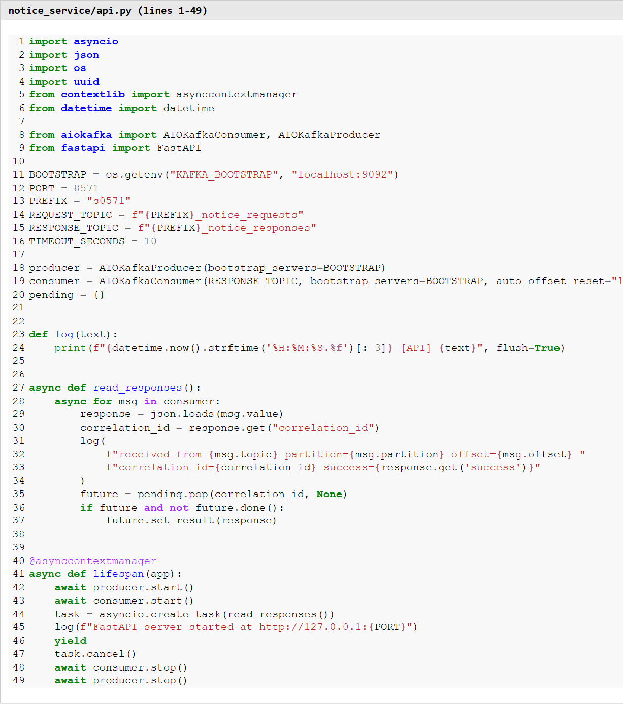

**Screenshot 2. FastAPI wrapper endpoint, notice_service/api.py**

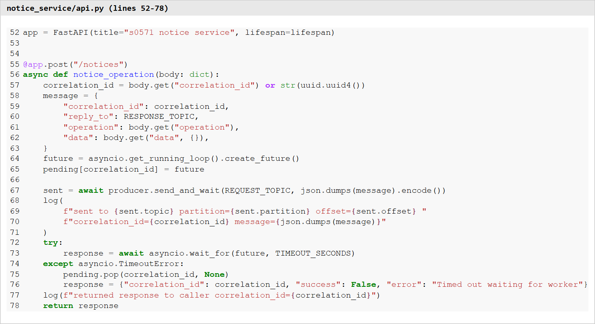

**Screenshot 3. Worker validation and operations, notice_service/worker.py**

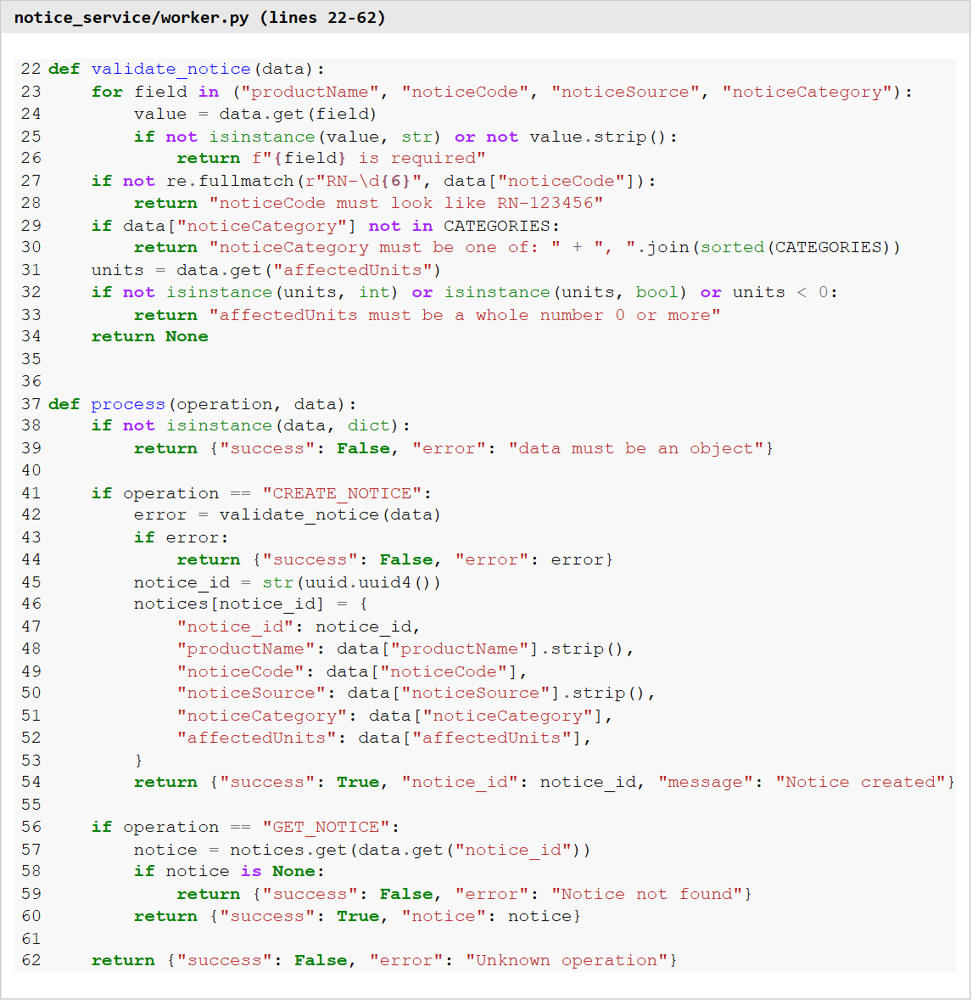

**Screenshot 4. Worker consume, process, reply loop, notice_service/worker.py**

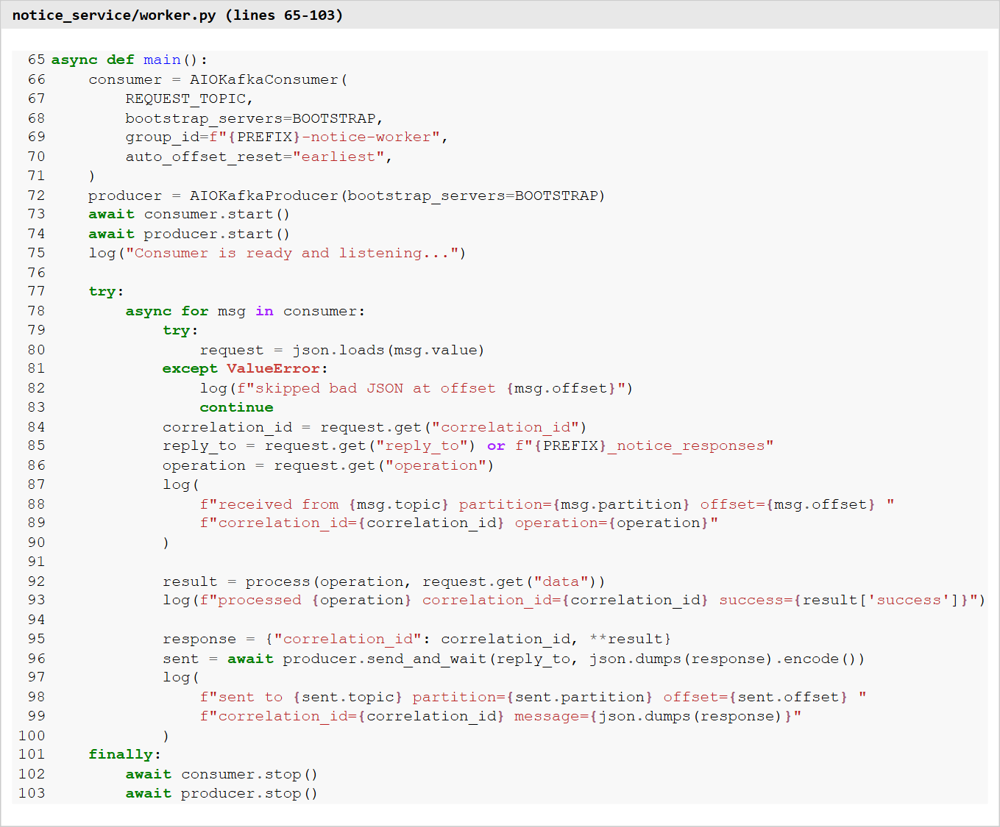

**Screenshot 5. homework_demo.py**

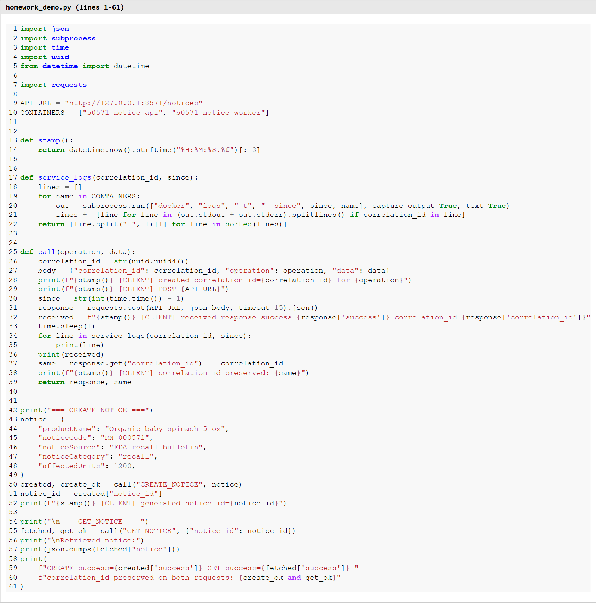

### IV. Evidence

**Screenshot 6. docker ps with Kafka, worker and FastAPI containers, worker "Consumer is ready and listening..." and FastAPI started at http://127.0.0.1:8571**

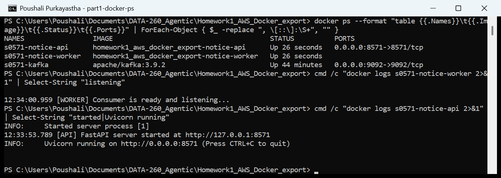

Uvicorn binds to 0.0.0.0 inside the container and Docker publishes port 8571 on the host, so the service is reached at http://127.0.0.1:8571, the address the app logs and the demo uses.

**Screenshot 7. python homework_demo.py: CREATE_NOTICE then GET_NOTICE, with the full send, receive, process, reply and client-response sequence**

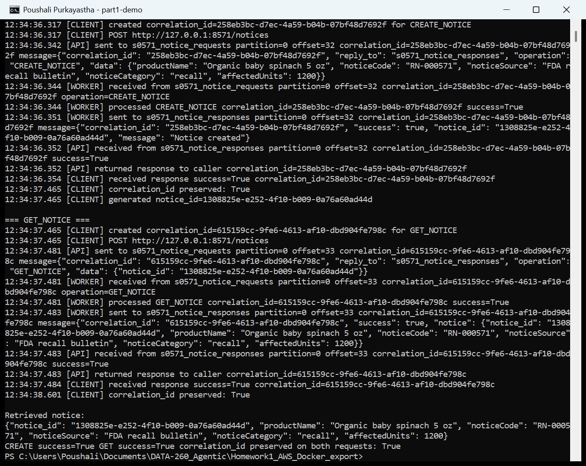

The screenshot shows both operations, the notice data, the generated notice_id, success true and the same correlation_id on every line. The demo prints its own lines (CLIENT) before and after the HTTP call. The API and WORKER lines in between are pulled from `docker logs -t` and sorted by Docker's own timestamps, because the Windows clock and the Docker VM clock differ by a few milliseconds.

Kafka message flow for CREATE_NOTICE (same run, from `raw/homework_demo_output.txt`, JSON shortened):

```
12:34:36.317 [CLIENT] created correlation_id=258eb3bc-... for CREATE_NOTICE
12:34:36.342 [API] sent to s0571_notice_requests partition=0 offset=32 correlation_id=258eb3bc-...
             message={"correlation_id": "258eb3bc-...", "reply_to": "s0571_notice_responses",
             "operation": "CREATE_NOTICE", "data": {...}}
12:34:36.344 [WORKER] received from s0571_notice_requests partition=0 offset=32 correlation_id=258eb3bc-...
12:34:36.344 [WORKER] processed CREATE_NOTICE correlation_id=258eb3bc-... success=True
12:34:36.351 [WORKER] sent to s0571_notice_responses partition=0 offset=32 correlation_id=258eb3bc-...
             message={"correlation_id": "258eb3bc-...", "success": true,
             "notice_id": "1308825e-e252-4f10-b009-0a76a60ad44d", "message": "Notice created"}
12:34:36.352 [API] received from s0571_notice_responses partition=0 offset=32 correlation_id=258eb3bc-... success=True
12:34:36.352 [API] returned response to caller correlation_id=258eb3bc-...
12:34:36.354 [CLIENT] received response success=True correlation_id=258eb3bc-...
12:34:37.465 [CLIENT] generated notice_id=1308825e-e252-4f10-b009-0a76a60ad44d
12:34:37.465 [CLIENT] created correlation_id=615159cc-... for GET_NOTICE
12:34:37.481 [API] sent to s0571_notice_requests partition=0 offset=33 ... "operation": "GET_NOTICE",
             "data": {"notice_id": "1308825e-e252-4f10-b009-0a76a60ad44d"}
12:34:37.481 [WORKER] received from s0571_notice_requests partition=0 offset=33 correlation_id=615159cc-...
12:34:37.481 [WORKER] processed GET_NOTICE correlation_id=615159cc-... success=True
12:34:37.483 [WORKER] sent to s0571_notice_responses partition=0 offset=33 ... "success": true, "notice": {...}
12:34:37.483 [API] received from s0571_notice_responses partition=0 offset=33 correlation_id=615159cc-...
12:34:37.483 [API] returned response to caller correlation_id=615159cc-...
12:34:37.484 [CLIENT] received response success=True correlation_id=615159cc-...
12:34:38.601 [CLIENT] correlation_id preserved: True
```

**Screenshot 8. Error responses: unknown operation, unknown notice_id and invalid fields, each with the original correlation_id**

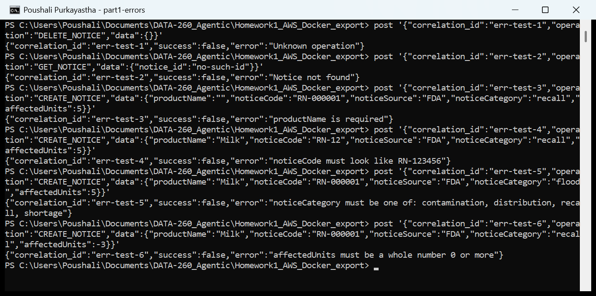

## Part 2: Three-Agent Kafka Pipeline

### I. Design

Planner, Writer and Reviewer are three separate processes. None of them imports or calls another; each one only reads its input topic and writes to the next topic. All three use qwen3:8b through the repository's `src/model_client.py`.

| Sender | Reads topic | Sends to | Message |
|---|---|---|---|
| send_question.py | - | s0571_inbox | {correlation_id, question} |
| planner.py | s0571_inbox | s0571_tasks | {correlation_id, question, plan} |
| writer.py | s0571_tasks | s0571_drafts | task fields + {draft, writer, task_partition, task_offset} |
| reviewer.py | s0571_drafts | s0571_final | {correlation_id, status, answer, review_note, question} |

Each agent uses its own consumer group (`s0571-planner`, `s0571-writer`, `s0571-reviewer`) and commits its offset only after it has sent its output. The Reviewer asks the model for JSON with a fixed schema (`status` approved or rejected, and a one sentence `note`).

### II. Code

Planner (`planner.py`, main loop):

```python
async for msg in consumer:
    question = json.loads(msg.value)
    correlation_id = question["correlation_id"]
    plan = await asyncio.to_thread(make_plan, question["question"])
    task = {"correlation_id": correlation_id, "question": question["question"], "plan": plan}
    sent = await producer.send_and_wait(TASKS, encode(task))
    await consumer.commit()
```

Writer (`writer.py`, the model call; the full loop with the Part 3 fixes is in Part 3):

```python
def write_draft(raw):
    task = json.loads(raw)
    if not task.get("question") or not task.get("plan"):
        raise ValueError("task is missing question or plan")
    messages = [
        {"role": "system", "content": SYSTEM},
        {"role": "user", "content": f"Question: {task['question']}\n\nPlan:\n{task['plan']}"},
    ]
    return task, llm.complete(messages).text
```

Reviewer (`reviewer.py`, main loop):

```python
async for msg in consumer:
    draft = json.loads(msg.value)
    correlation_id = draft["correlation_id"]
    verdict = await asyncio.to_thread(review, draft)
    final = {"correlation_id": correlation_id, "status": verdict["status"], "answer": draft["draft"],
             "review_note": verdict["note"], "question": draft["question"]}
    sent = await producer.send_and_wait(FINAL, encode(final))
    await consumer.commit()
```

`send_question.py` assigns itself to `s0571_final` at the end offset, sends the question to `s0571_inbox` and waits for the final message with its correlation_id.

### III. Running the agents (four terminals)

**Screenshot 9. Terminal 1: python planner.py**

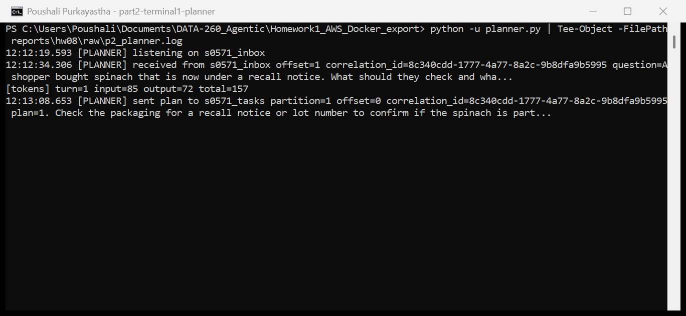

**Screenshot 10. Terminal 2: python writer.py**

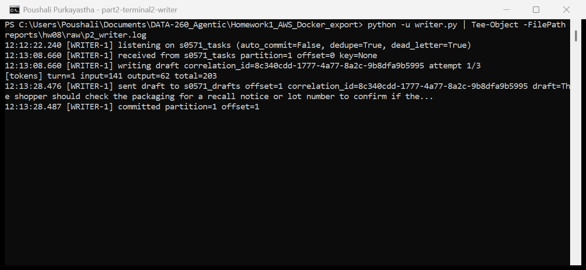

**Screenshot 11. Terminal 3: python reviewer.py**

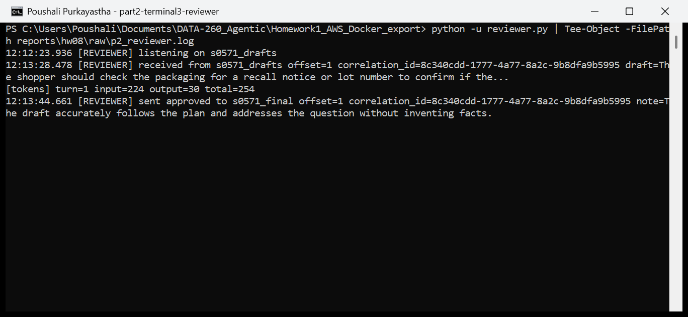

**Screenshot 12. Terminal 4: python send_question.py, with the final JSON read from s0571_final**

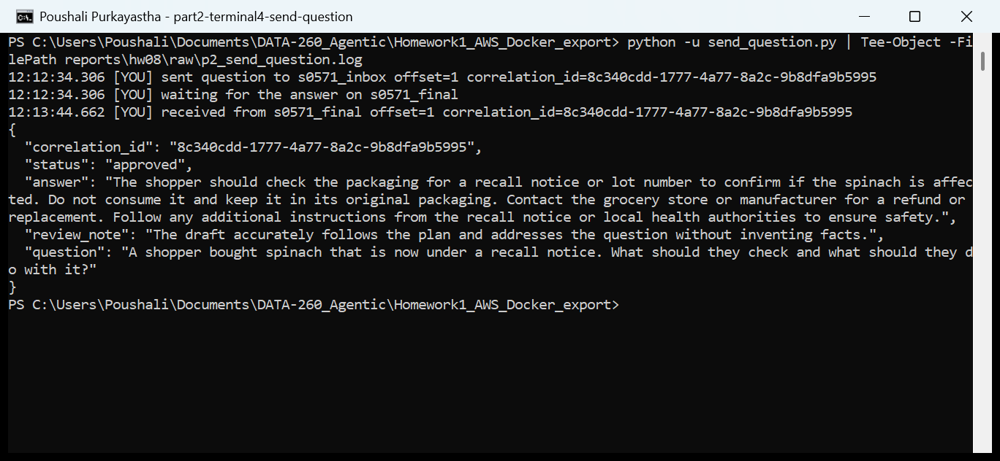

### IV. One message journey from s0571_inbox to s0571_final

```
12:12:34.306 [YOU] sent question to s0571_inbox offset=1 correlation_id=8c340cdd-1777-4a77-8a2c-9b8dfa9b5995
12:12:34.306 [PLANNER] received from s0571_inbox offset=1 correlation_id=8c340cdd-... question=A shopper bought spinach...
12:13:08.653 [PLANNER] sent plan to s0571_tasks partition=1 offset=0 correlation_id=8c340cdd-... plan=1. Check the packaging...
12:13:08.660 [WRITER-1] received from s0571_tasks partition=1 offset=0 key=None
12:13:28.476 [WRITER-1] sent draft to s0571_drafts offset=1 correlation_id=8c340cdd-... draft=The shopper should check...
12:13:28.478 [REVIEWER] received from s0571_drafts offset=1 correlation_id=8c340cdd-...
12:13:28.487 [WRITER-1] committed partition=1 offset=1
12:13:44.661 [REVIEWER] sent approved to s0571_final offset=1 correlation_id=8c340cdd-... note=The draft accurately follows the plan...
12:13:44.662 [YOU] received from s0571_final offset=1 correlation_id=8c340cdd-1777-4a77-8a2c-9b8dfa9b5995
```

Final JSON message on `s0571_final`:

```
{
  "correlation_id": "8c340cdd-1777-4a77-8a2c-9b8dfa9b5995",
  "status": "approved",
  "answer": "The shopper should check the packaging for a recall notice or lot number to confirm if the
             spinach is affected. Do not consume it and keep it in its original packaging. Contact the
             grocery store or manufacturer for a refund or replacement. Follow any additional instructions
             from the recall notice or local health authorities to ensure safety.",
  "review_note": "The draft accurately follows the plan and addresses the question without inventing facts.",
  "question": "A shopper bought spinach that is now under a recall notice. What should they check and what
               should they do with it?"
}
```

The whole journey took 70.4 s: 34.3 s in the Planner (the model was still loading), 19.8 s in the Writer and 16.2 s in the Reviewer.

### V. How Kafka helped the agents coordinate

Kafka was the only link between the agents. The Planner did not need to know the Writer existed: it wrote a plan to `s0571_tasks` and moved on. Each topic acted as a queue that kept the work until the next agent was ready, so the agents could start in any order and a slow model call in one agent did not block the others from taking new messages. The correlation_id inside every message tied the four messages of one question together, which is how `send_question.py` picked its own answer out of `s0571_final`. The topics also kept a record of every step (partition and offset in each log line), so I could replay or inspect any message later, which is what made the Part 3 tests possible. Consumer groups with committed offsets meant a restarted agent continued where it stopped instead of starting over.

## Part 3: Failure Behavior

The fixes are all in `writer.py`. Each fix has a flag that turns it off, so the same code shows the behavior before and after: `--no-dedupe` (no idempotency), `--auto-commit` (offsets committed in the background, as in the class demo) and `--no-dlq` (an exception crashes the writer).

### I. Duplicate delivery

`replay_task.py <correlation_id>` finds the original task in `s0571_tasks` and sends the same bytes again, with the same key and partition. Idempotency code in `writer.py`:

```python
DONE_FILE = Path("state/writer_done.txt")
...
done = set() if args.no_dedupe else load_done()
...
if correlation_id in done:
    log(NAME, f"duplicate correlation_id={correlation_id}, already processed, skipped")
else:
    ...write the draft and send it to s0571_drafts...
    if not args.no_dedupe:
        done.add(correlation_id)
        mark_done(correlation_id)      # appended to state/writer_done.txt, survives a restart
```

Before fix (`python writer.py --no-dedupe`):

```
12:16:23.008 [WRITER-1] sent draft to s0571_drafts offset=2 correlation_id=60b8fbaf-... (first delivery)
12:16:43.106 [REVIEWER] sent approved to s0571_final offset=2 correlation_id=60b8fbaf-...
12:16:48.342 [REPLAY] original at s0571_tasks partition=0 offset=1, replayed unchanged as offset=2 correlation_id=60b8fbaf-...
12:16:48.342 [WRITER-1] received from s0571_tasks partition=0 offset=2 key=None
12:16:48.342 [WRITER-1] writing draft correlation_id=60b8fbaf-... attempt 1/3
[tokens] turn=2 input=208 output=88 total=296
12:17:05.094 [WRITER-1] sent draft to s0571_drafts offset=3 correlation_id=60b8fbaf-...
12:17:14.945 [REVIEWER] sent approved to s0571_final offset=3 correlation_id=60b8fbaf-...
s0571_final messages with this correlation_id: Offset:2 and Offset:3
```

After fix (`python writer.py`):

```
12:19:07.439 [REPLAY] original at s0571_tasks partition=1 offset=1, replayed unchanged as offset=2 correlation_id=cb207d2f-...
12:19:07.439 [WRITER-1] received from s0571_tasks partition=1 offset=2 key=None
12:19:07.439 [WRITER-1] duplicate correlation_id=cb207d2f-..., already processed, skipped
12:19:07.448 [WRITER-1] committed partition=1 offset=3
s0571_final messages with this correlation_id: Offset:4 only
```

### II. Consumer death

Offset-commit code in `writer.py`: auto-commit is off, and the offset is committed only after the draft (or the dead-letter record) has been sent.

```python
consumer = AIOKafkaConsumer(TASKS, bootstrap_servers=BOOTSTRAP, group_id=f"{PREFIX}-writer",
                            auto_offset_reset="earliest", enable_auto_commit=args.auto_commit)
...
sent = await producer.send_and_wait(DRAFTS, encode(out))
...
if not args.auto_commit:
    await consumer.commit({TopicPartition(msg.topic, msg.partition): msg.offset + 1})
```

In both runs I sent a new question, waited until the Writer logged "writing draft", waited 8 s more and killed the Writer with `Stop-Process -Force`, then checked the group with `kafka-consumer-groups.sh --describe --group s0571-writer` and restarted the Writer.

Before fix (`python writer.py --auto-commit`):

```
12:20:45.075 [WRITER-1] received from s0571_tasks partition=0 offset=3 key=None
12:20:45.075 [WRITER-1] writing draft correlation_id=c3a07346-... attempt 1/3
killed writer pid 23148 (12:20:53)
GROUP         TOPIC        PARTITION  CURRENT-OFFSET  LOG-END-OFFSET  LAG
s0571-writer  s0571_tasks  0          4               4               0      <- offset 3 already committed
12:21:07.246 [WRITER-1] listening on s0571_tasks (auto_commit=True, ...)   <- restarted, then nothing for 100 s
drafts with c3a07346-...: 0, send_question.py never received an answer
```

The background auto-commit ran every 5 s while the model was still writing, so Kafka recorded the task as done before any draft existed. After the restart the Writer started at offset 4 and the question was lost.

After fix (`python writer.py`):

```
12:23:40.360 [WRITER-1] received from s0571_tasks partition=0 offset=4 key=None
12:23:40.360 [WRITER-1] writing draft correlation_id=053b51ef-... attempt 1/3
killed writer pid 22064
GROUP         TOPIC        PARTITION  CURRENT-OFFSET  LOG-END-OFFSET  LAG
s0571-writer  s0571_tasks  0          4               5               1      <- offset 4 not committed
12:23:57.770 [WRITER-1] listening on s0571_tasks (auto_commit=False, ...)
12:23:57.770 [WRITER-1] received from s0571_tasks partition=0 offset=4 key=None   <- redelivered
12:24:16.438 [WRITER-1] sent draft to s0571_drafts offset=5 correlation_id=053b51ef-...
12:24:16.442 [WRITER-1] committed partition=0 offset=5
12:24:35.211 [YOU] received from s0571_final offset=5 correlation_id=053b51ef-... status approved
```

If the Writer died after sending the draft but before the commit, the task would come back once more. That case is covered by the idempotency check from I, because the correlation_id is written to the done file right after the draft is sent.

### III. Poison message

`send_poison.py` sends a cut-off JSON message and then a normal task, both with key `poison-test` so they land in the same partition. Retry and dead-letter code in `writer.py`:

```python
for attempt in range(1, MAX_ATTEMPTS + 1):        # MAX_ATTEMPTS = 3
    try:
        task, draft = await asyncio.to_thread(write_draft, msg.value)
        break
    except Exception as error:
        last_error = str(error)
        if args.no_dlq:
            raise
        await asyncio.sleep(1)
else:
    record = {"correlation_id": correlation_id, "source_topic": TASKS, "partition": msg.partition,
              "offset": msg.offset, "error": last_error, "attempts": MAX_ATTEMPTS,
              "raw": msg.value.decode(errors="replace")}
    sent = await producer.send_and_wait(DEAD_LETTER, encode(record))
    task = None
# the offset is committed after this, so the next message can be read
```

Before fix (`python writer.py --no-dlq`, started twice):

```
12:24:51.202 [POISON] sent malformed task to s0571_tasks partition=1 offset=3
12:24:51.203 [POISON] sent normal task behind it partition=1 offset=4 correlation_id=9420a1c6-...
=== run 1
12:24:55.938 [WRITER-1] received from s0571_tasks partition=1 offset=3 key=b'poison-test'
12:24:55.939 [WRITER-1] attempt 1/3 failed: Unterminated string starting at: line 1 column 51 (char 50)
json.decoder.JSONDecodeError: Unterminated string starting at: line 1 column 51 (char 50)   exit code 1
=== run 2, restarted
12:24:59.444 [WRITER-1] received from s0571_tasks partition=1 offset=3 key=b'poison-test'
json.decoder.JSONDecodeError: Unterminated string starting at: line 1 column 51 (char 50)   exit code 1
GROUP         TOPIC        PARTITION  CURRENT-OFFSET  LOG-END-OFFSET  LAG
s0571-writer  s0571_tasks  1          3               5               2      <- stuck, offset 4 never read
```

After fix (`python writer.py`):

```
12:25:22.875 [WRITER-1] received from s0571_tasks partition=1 offset=3 key=b'poison-test'
12:25:22.877 [WRITER-1] attempt 1/3 failed: Unterminated string starting at: line 1 column 51 (char 50)
12:25:23.899 [WRITER-1] attempt 2/3 failed: Unterminated string starting at: line 1 column 51 (char 50)
12:25:24.899 [WRITER-1] attempt 3/3 failed: Unterminated string starting at: line 1 column 51 (char 50)
12:25:25.925 [WRITER-1] gave up after 3 attempts, moved to s0571_dead_letter offset=0
12:25:25.928 [WRITER-1] committed partition=1 offset=4
12:25:25.928 [WRITER-1] received from s0571_tasks partition=1 offset=4 key=b'poison-test'
12:26:03.835 [WRITER-1] sent draft to s0571_drafts offset=6 correlation_id=9420a1c6-...
12:26:03.913 [WRITER-1] committed partition=1 offset=5
s0571_dead_letter Offset:0 {"correlation_id": null, "source_topic": "s0571_tasks", "partition": 1, "offset": 3,
  "error": "Unterminated string starting at: line 1 column 51 (char 50)", "attempts": 3,
  "raw": "{\"correlation_id\": \"poison-08a1b4fb\", \"question\": \"Which lots are"}
```

### IV. Ordering

`order_test.py` builds 20 related messages with `random.Random(260571)`: each picks one of four products and gets the next update number (seq) for that product. It sends them to `s0571_tasks` (two partitions) while two Writers run in the same group `s0571-writer` (writer-1 and writer-2, one partition each), then reads `s0571_drafts` and records the order in which the drafts came out. Partition-key code:

```python
for m in messages:
    key = m["entity"].encode() if keyed else None
    sent = await producer.send_and_wait(TASKS, encode(m), key=key)
```

Run 1, no key (`python order_test.py`), drafts in the order they were finished:

```
#1 Smoked salmon seq=1 p0 writer-2     #11 Organic baby spinach seq=2 p0 writer-2
#2 Smoked salmon seq=2 p1 writer-1     #12 Creamy peanut butter seq=3 p1 writer-1
#3 Creamy peanut butter seq=1 p0       #13 Smoked salmon seq=6 p0 writer-2
#4 Frozen chicken nuggets seq=1 p1     #14 Smoked salmon seq=5 p1 writer-1
#5 Smoked salmon seq=3 p0              #15 Creamy peanut butter seq=4 p0
#6 Frozen chicken nuggets seq=2 p1     #16 Frozen chicken nuggets seq=3 p1
#7 Organic baby spinach seq=1 p0       #17 Smoked salmon seq=7 p0
#8 Creamy peanut butter seq=2 p1       #18 Smoked salmon seq=8 p1
#9 Smoked salmon seq=4 p0              #19 Frozen chicken nuggets seq=4 p0
#10 Organic baby spinach seq=3 p1      #20 Organic baby spinach seq=4 p1
Summary (nokey):
  Organic baby spinach 5 oz    processed seq order [1, 3, 2, 4]  partitions [0, 1]  in order: False
  Creamy peanut butter 16 oz   processed seq order [1, 2, 3, 4]  partitions [0, 1]  in order: True
  Frozen chicken nuggets 2 lb  processed seq order [1, 2, 3, 4]  partitions [0, 1]  in order: True
  Smoked salmon 12 oz          processed seq order [1, 2, 3, 4, 6, 5, 7, 8]  partitions [0, 1]  in order: False
```

Run 2, key = product name (`python order_test.py --keyed`):

```
Summary (keyed):
  Organic baby spinach 5 oz    processed seq order [1, 2, 3, 4]  partitions [0]  in order: True
  Creamy peanut butter 16 oz   processed seq order [1, 2, 3, 4]  partitions [1]  in order: True
  Frozen chicken nuggets 2 lb  processed seq order [1, 2, 3, 4]  partitions [0]  in order: True
  Smoked salmon 12 oz          processed seq order [1, 2, 3, 4, 5, 6, 7, 8]  partitions [1]  in order: True
```

Without a key the producer spread each product over both partitions, and the two Writers worked on them at the same time, so spinach update 3 finished before update 2 and salmon update 6 before update 5. With the product name as the key, Kafka hashed every message for one product to the same partition, which only one Writer reads, so each product's updates were processed in the order they were sent. Both Writers stayed busy because two products hash to each partition. Order is only kept per key, not across products, which is all this case needs. Full rows: `raw/ordering_nokey.csv`, `raw/ordering_keyed.csv`.

### V. Failure table

| Failure scenario | Before fix | After fix |
|---|---|---|
| Duplicate delivery | Replayed task processed again: 2 model calls, 2 drafts, 2 messages on s0571_final (offsets 2 and 3) for one correlation_id | Replay logged as duplicate and skipped, offset committed: 1 model call, 1 draft, 1 final message (offset 4) |
| Consumer killed mid-work | Auto-commit had already committed offset 3 (lag 0). After restart the task was never read again: 0 drafts, no answer | Offset 4 stayed uncommitted (lag 1). After restart offset 4 was redelivered, the draft was sent, offset 5 committed, the answer arrived |
| Poison message | Writer crashed on partition 1 offset 3 on every start; lag 2, the normal task at offset 4 was blocked | 3 attempts, then moved to s0571_dead_letter offset 0; offset committed; the normal task at offset 4 was processed at once |
| Two partitions/two consumers | No key: every product in both partitions; spinach processed 1, 3, 2, 4 and salmon 1, 2, 3, 4, 6, 5, 7, 8 | Key = product: each product in one partition; 4 of 4 products in order |

### VI. Comparison with the HW2 in-process graph

In HW2 the LangGraph graph (`agent_graph.py`) ran every step as a function call in one Python process, and each node waited for the previous one to return.

Benefits gained with Kafka:

1. Decoupled failure. When the Writer died in II, the Planner and Reviewer kept running and the task stayed in `s0571_tasks`. After the restart the Writer picked it up and the question was still answered. In HW2 a crash in one node ended the whole run and the work in progress was gone.
2. Independent scaling. In IV I ran a second Writer just by starting another process in the same consumer group. Kafka split the two partitions between them, and the Planner and Reviewer did not change at all. In HW2 the only way to scale was to run the whole graph again.

New responsibilities I now handle myself:

1. Duplicate delivery. Kafka delivers at least once, so the same task can arrive twice (a replay, or a crash between sending the draft and committing). In HW2 a function was called exactly once. Now the Writer needs the idempotency check on correlation_id.
2. Ordering. Kafka only keeps order inside one partition. With two partitions and two consumers related messages can finish out of order, so I have to choose a message key. In HW2 the steps simply ran in sequence.

I also had to decide when to commit offsets and what to do with a message that always fails (retries and the dead-letter topic). Neither of those existed when everything was a function call.

## Verification

`python verify_hw08.py` (`make verify-hw08`) runs on the tagged commit and writes `reports/hw08/verification.json`. It checks the topic layout, the CREATE_NOTICE to GET_NOTICE round trip through Kafka, that correlation_ids come back unchanged, the clean error responses, then starts the three agents and checks one inbox-to-final journey, an idempotent replay, and a poison message that is retried 3 times, dead-lettered and does not block the next message. It does not change any application code. Its agent logs go to a temporary folder, and the Writer it starts appends the new correlation_ids to the git-ignored `state/writer_done.txt`, the same as in a normal run.

Result on the tagged commit (`verification.json`: homework 8, SID4 0571, commit and tag hw8 = 0f1ed55, qwen3:8b, SEED 571, VERIFY_SEED 260571):

```
PASS topics_and_partitions: {'s0571_notice_responses': 1, 's0571_tasks': 2, 's0571_notice_requests': 1, 's0571_drafts': 1, 's0571_dead_letter': 1, 's0571_inbox': 1, 's0571_final': 1}
PASS create_then_get_round_trip: notice_id 82ea628b-1ad2-4983-b37d-0ebbe83287e3, fields match True
PASS correlation_id_preserved: ['verify-create', 'verify-get']
PASS errors_clean_and_keep_correlation_id: ['Unknown operation', 'Notice not found', 'productName is required']
PASS agents_start: planner, writer and reviewer are listening
PASS inbox_to_final_journey: status approved, correlation_id kept
PASS replay_is_idempotent: replay skipped, 1 draft
PASS poison_retried_then_dead_lettered: 3 failed attempts, dead letter count 2 -> 3
PASS poison_does_not_block: next message on the same partition was processed
PASS report_files_present: all present
10/10 checks passed, written to reports/hw08/verification.json
```

## AI Use

1. I used an AI assistant for debugging and for preparing the report document (`report.md` and the PDF). The debugging help covered the Kafka listener settings so that both the containers and the host scripts can reach the broker, the Git Bash path conversion that broke `docker exec` on Windows, and the PowerShell quirks in the screenshot commands. I chose the topic layout, the message schemas and the notice validation rules, wrote the worker, the FastAPI wrapper, the three agents and the failure fixes (idempotency file, commit after processing, bounded retries with a dead-letter topic, entity keys), ran every experiment on my laptop and checked the results against the Kafka consumer group offsets.

2. One output that was wrong: when I asked for help merging the client lines and the container log lines in `homework_demo.py`, the suggestion was to sort all lines by their printed timestamp. The first output then showed the client receiving the CREATE_NOTICE response at 11:54:56.208, before the worker had sent it at 11:54:56.209. That order is impossible.

3. I found it by reading the demo output line by line and checking that every step happened after the step that caused it. The cause was clock skew of a few milliseconds between Windows and the Docker Desktop VM, plus lines in the same millisecond being sorted alphabetically. I also did not trust the agent logs alone for the consumer-death test: I checked `kafka-consumer-groups.sh --describe` right after each kill to see which offset was really committed.

4. The demo now prints its own lines before and after the request, and sorts only the container lines, using the nanosecond timestamps that `docker logs -t` adds. Both containers share the Docker VM clock, so that order is reliable, and the output follows the real send, receive, process, reply sequence.
