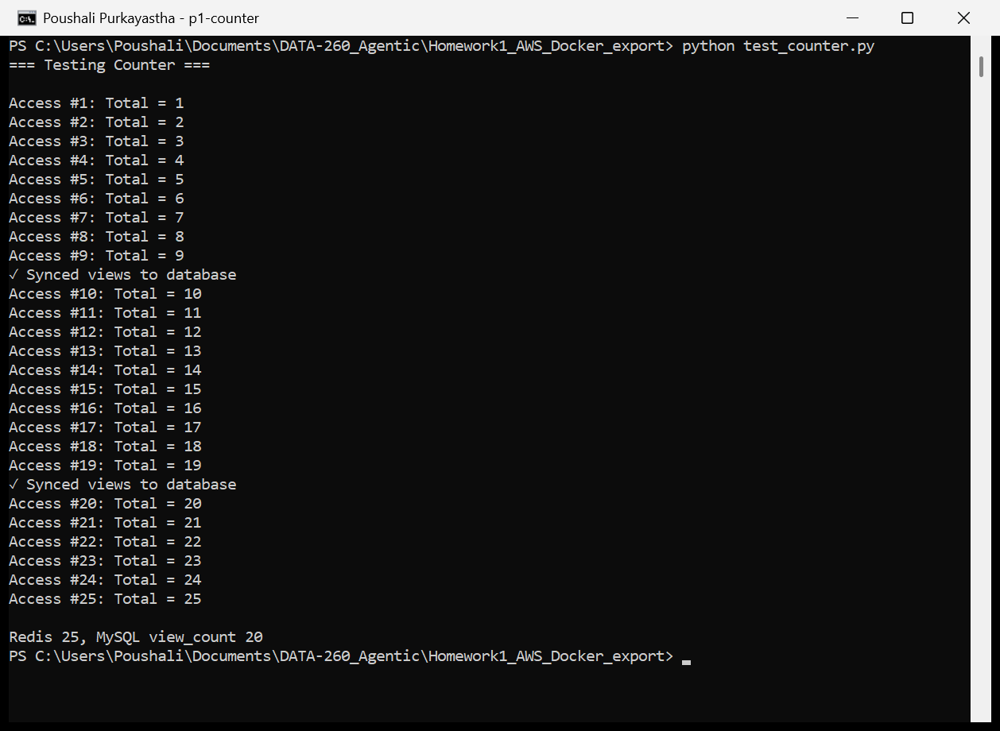
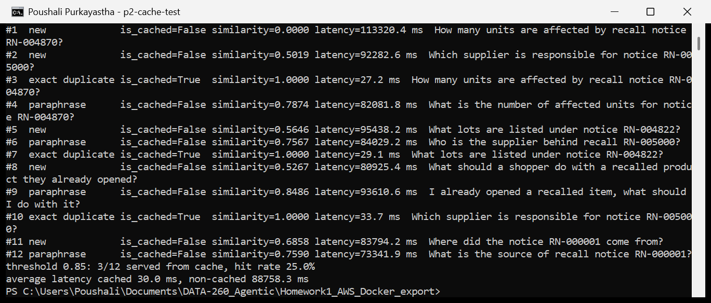
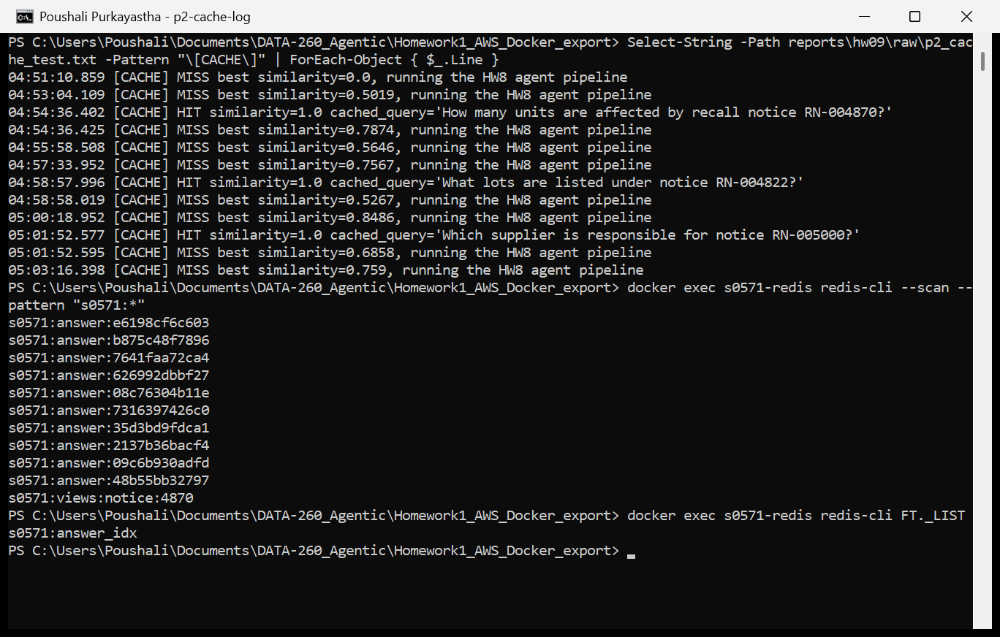
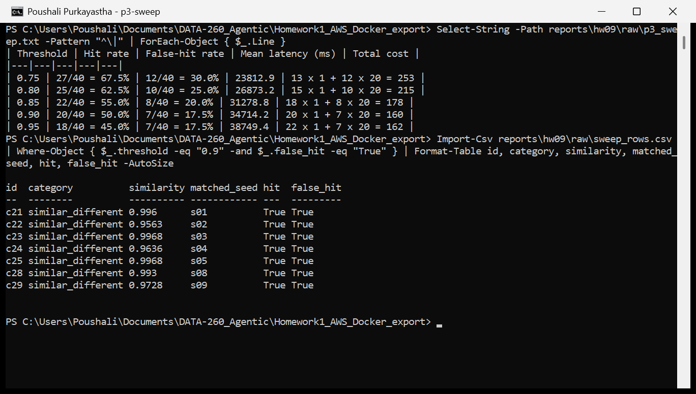
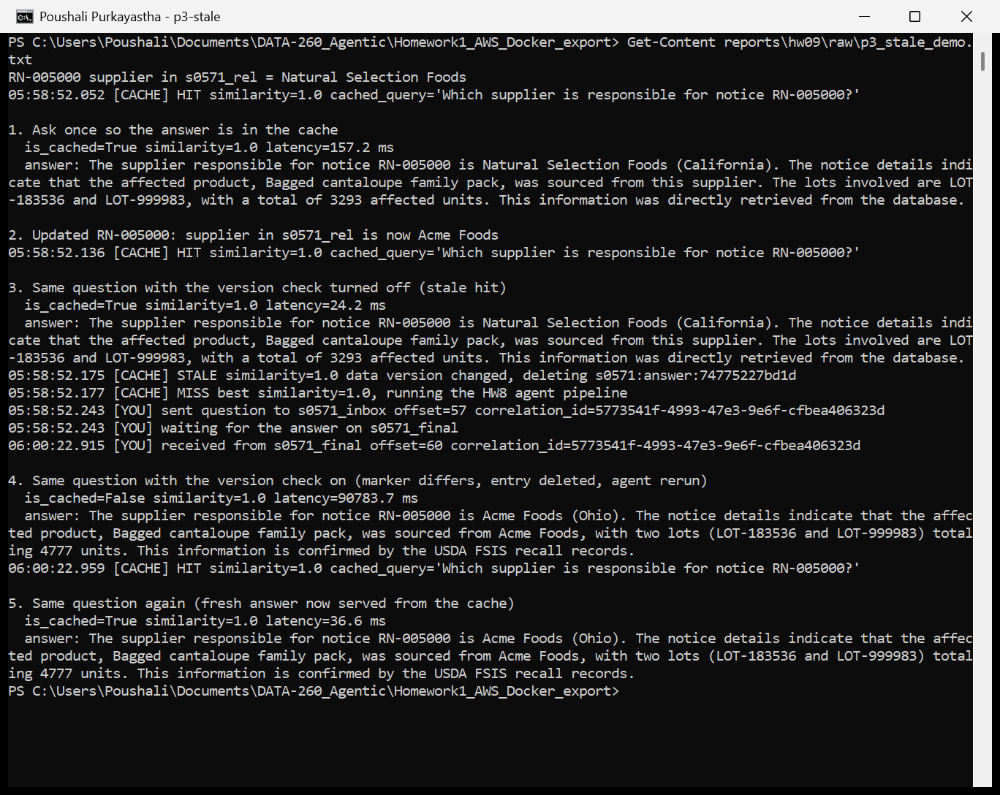
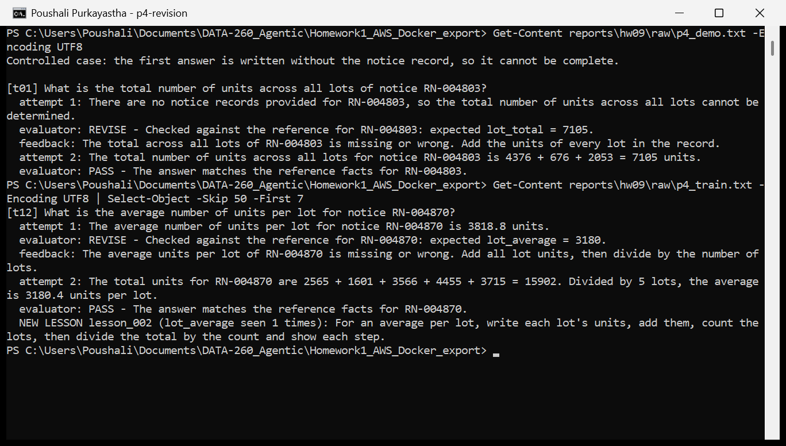
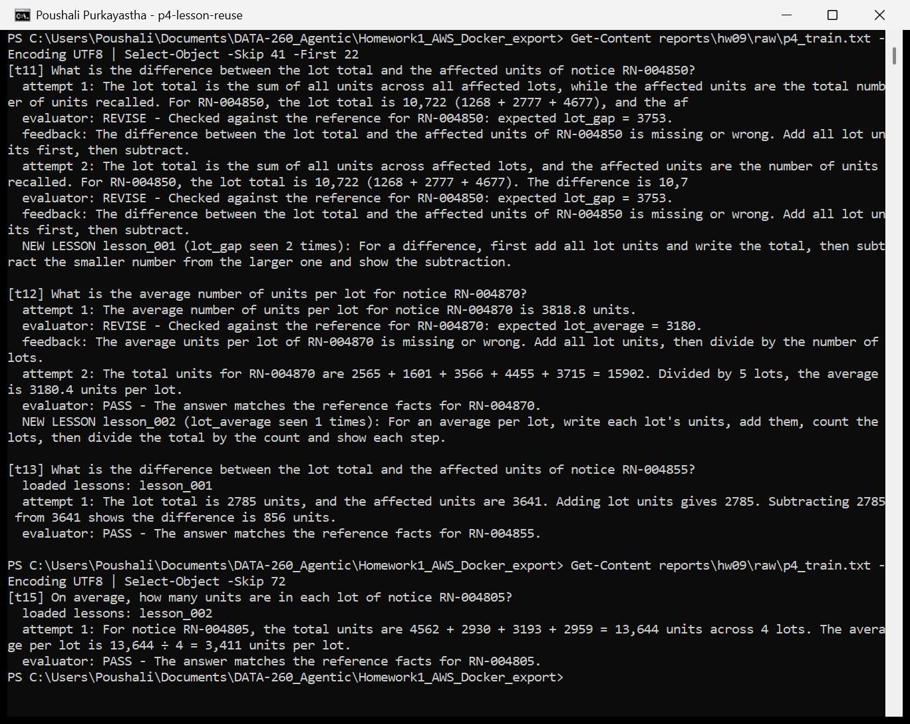
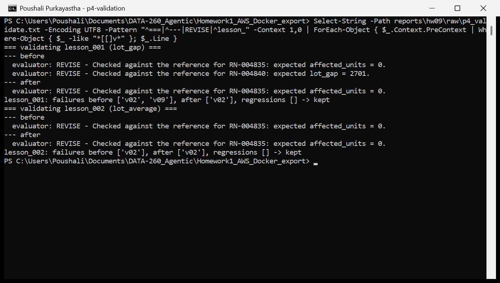
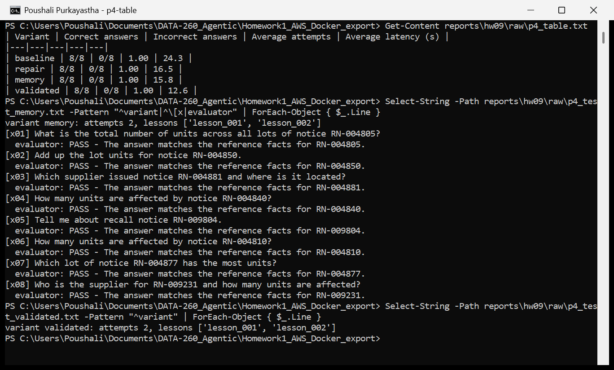

# DATA-260 Homework 9: Redis Counter, Semantic Cache, Threshold Economics and a Self-Improving Two-Agent System

**Poushali Purkayastha**

**GitHub repository:** https://github.com/Poushali0202/data260-0571 (collaborators Sbnikitha and supriyaselvanganesan have access)

## Section 0: Configuration

| Value | Result |
|---|---|
| SID4 | 0571 |
| PORT_BASE | 8000 + (571 mod 900) = 8571 |
| PREFIX | s0571 (every Redis key starts with `s0571:`) |
| SEED | 571 |
| VERIFY_SEED | 260000 + 571 = 260571 |
| DOMAIN_ID | 571 mod 8 = 3 (grocery supply and recall notices, entity GroceryNotice) |
| Hardware | Intel Core i5-1135G7, 15.8 GB RAM, Windows 11 Home, CPU only |
| Local model | qwen3:8b through Ollama 0.40.14, temperature 0, called only through `src/model_client.py` |
| Cache | Redis Stack 7.4.0 in Docker (container s0571-redis, search module for the vector index), redis-py 8.1.0 |
| Embeddings | sentence-transformers 6.0.1, all-MiniLM-L6-v2 (384 dimensions, normalized) |
| Relational data | MySQL 8.0 database s0571_rel (5000 grocery notices, 200 lots, 20 suppliers) |
| Tagged commit | hw9 = 69ee498a98ad86af57ea0e111d8b2b7ba2fe6d60 |

New code at the repository root: `notice_cache.py`, `test_counter.py`, `notice_facts.py`, `semantic_cache.py`, `cached_ask.py`, `run_cache_test.py`, `cache_cases.yaml`, `run_threshold_sweep.py`, `stale_demo.py`, `migrations/hw09_view_count.sql` and the folder `self_improving/`. Changed: `models.py` (view_count column), `send_question.py` (reusable `ask_pipeline`), `planner.py`, `writer.py` and `reviewer.py` (they pass on and use the notice records), `docker-compose.yml` (Redis service).

## Part 1: Redis View Counter

The new column `view_count` was added to `grocery_notices` with `migrations/hw09_view_count.sql`. The new method is on `NoticeCache` in `notice_cache.py`:

```
def increment_notice_views(self, notice_id):
    key = f"{PREFIX}:views:notice:{notice_id}"
    count = self.redis_client.incr(key)
    if count % SYNC_EVERY == 0:
        with db_session_basede26() as db:
            db.execute(
                update(GroceryNotice)
                .where(GroceryNotice.id == notice_id)
                .values(viewCount=count, updatedAt=GroceryNotice.updatedAt)
            )
            db.commit()
        print("✓ Synced views to database")
    return count
```

Every view is one Redis INCR on `s0571:views:notice:4870`. Only every tenth view writes to MySQL. `updatedAt` is kept as it is on purpose, because a view is not a change to the notice and the cache in Part 2 must not treat it as one. `test_counter.py` resets the key and calls the method 25 times. The sync message is printed inside the tenth and twentieth call, so it appears just before the Access #10 and #20 lines. At the end Redis holds 25 and MySQL holds 20, the last multiple of 10.

**Screenshot 1. test_counter.py, 25 accesses, Redis and MySQL values at the end**



## Part 2: Semantic Response Cache

### Design

The cache sits at the ingress of the HW8 Kafka pipeline, in `cached_ask.py`. `ask(question)` does the following:

1. Embed the question with all-MiniLM-L6-v2 (normalized, 384 floats).
2. KNN 1 search in the Redis vector index `s0571:answer_idx` (FLAT, COSINE). Redis returns the cosine distance, and similarity = 1 - distance.
3. If similarity >= threshold (0.85 to start), check the data-version marker (Part 3.5), log `HIT` with the similarity and return the stored final answer with `is_cached=True`. The agents are not called.
4. Otherwise log `MISS`, read the notice records named in the question from s0571_rel (`notice_facts.py`), send the question and the records through the normal HW8 path (`s0571_inbox`, Planner, Writer, Reviewer, `s0571_final`, all on qwen3:8b through the model adapter), store the query, its embedding, the final answer, the notice codes and the data-version marker in a Redis hash `s0571:answer:<id>`, and return with `is_cached=False`.

Each response carries `is_cached`, `similarity`, `latency_ms` and the timings of each step (`embed_ms`, `search_ms`, `version_check_ms`, `agent_ms`), taken with `time.perf_counter()` before and after each operation. The HW8 agents only needed small changes: the Planner forwards every field of the question message, and the Writer and Reviewer add the notice records to their prompts.

```
if match and similarity >= threshold:
    stale = False
    if check_version:
        stale = data_version(facts_for(match["codes"])) != match["data_version"]
    if not stale:
        log("CACHE", f"HIT similarity={similarity} cached_query={match['query']!r}")
        return {..., "is_cached": True, "similarity": similarity, "latency_ms": ...}
    cache.delete(match["key"])
log("CACHE", f"MISS best similarity={similarity}, running the HW8 agent pipeline")
facts = facts_for(notice_codes(question))
final = asyncio.run(ask_pipeline(question, facts))
cache.store(question, embedding, final["answer"], codes, data_version(facts))
```

### Test with 12 queries (threshold 0.85, empty cache at the start)

| # | Kind | Query | is_cached | Similarity | Latency (ms) |
|---|---|---|---|---|---|
| 1 | new | How many units are affected by recall notice RN-004870? | False | 0.0000 | 113320.4 |
| 2 | new | Which supplier is responsible for notice RN-005000? | False | 0.5019 | 92282.6 |
| 3 | exact duplicate | How many units are affected by recall notice RN-004870? | True | 1.0000 | 27.2 |
| 4 | paraphrase | What is the number of affected units for notice RN-004870? | False | 0.7874 | 82081.8 |
| 5 | new | What lots are listed under notice RN-004822? | False | 0.5646 | 95438.2 |
| 6 | paraphrase | Who is the supplier behind recall RN-005000? | False | 0.7567 | 84029.2 |
| 7 | exact duplicate | What lots are listed under notice RN-004822? | True | 1.0000 | 29.1 |
| 8 | new | What should a shopper do with a recalled product they already opened? | False | 0.5267 | 80925.4 |
| 9 | paraphrase | I already opened a recalled item, what should I do with it? | False | 0.8486 | 93610.6 |
| 10 | exact duplicate | Which supplier is responsible for notice RN-005000? | True | 1.0000 | 33.7 |
| 11 | new | Where did the notice RN-000001 come from? | False | 0.6858 | 83794.2 |
| 12 | paraphrase | What is the source of recall notice RN-000001? | False | 0.7590 | 73341.9 |

| Result | Value |
|---|---|
| Cache hit rate | 3 of 12 = 25.0% |
| Average latency, cached (3 queries) | 30.0 ms |
| Average latency, not cached (9 queries) | 88,758.3 ms (88.8 s) |

**Screenshot 2. run_cache_test.py, flag, similarity and latency for each query and the summary**



**Screenshot 3. HIT and MISS log lines with similarity, and the s0571 keys in Redis**



Only the three exact duplicates hit. All four paraphrases missed at 0.85: their similarities were 0.757, 0.759, 0.787 and 0.849. MiniLM gives a lot of weight to the wording, so "Who is the supplier behind recall RN-005000?" is only 0.757 away from "Which supplier is responsible for notice RN-005000?". A cached answer took 27 to 34 ms (embedding, KNN search and the version check), against 73 to 113 s for the agent path, which is three qwen3:8b calls on the CPU. The cached path was about 3000 times faster here, but that ratio is only what this laptop measured, and the hit rate is what decides the real saving.

The cache also keeps mistakes. The first answer for RN-004870 said "a total of 16,102 units", while the notice's affected units are 0 and its five lots add up to 15,902. The exact duplicate (#3) got the same wrong number in 27 ms. A cache does not check answers, it only repeats them.

## Part 3: Threshold Economics and Stale Answers

### 3.1 Labeled test set

`cache_cases.yaml` was committed in its own commit (014e5a1) before the sweep ran. It has 10 seed queries, which are answered by the agents and stored first, and 40 labeled cases: 10 exact duplicates of the seeds and 10 paraphrases (both should hit, each with the id of the seed that holds the correct answer), 10 superficially similar questions with a different correct answer (mostly the same question about a different notice code), and 10 unrelated questions (all should miss).

Labeling note, kept here and not in the file: c33 ("How many suppliers are in the database?") and c37 ("Which notice has the highest number of affected units?") are labeled unrelated, but they are about the notice data. They are not answered by any seed, so "should miss" is still right, and both missed at every threshold. Nothing was relabeled.

### 3.2 Threshold sweep

`run_threshold_sweep.py` clears the cache, stores the 10 seed answers, and then sends each case. A case counts as a hit when its nearest stored query has similarity >= threshold. A false hit is a hit that returns an answer that is wrong for the incoming query: a should-miss case that hits, or a should-hit case that hits a different seed. Hit rate and false-hit rate are out of all 40 cases. Mean latency covers all 40 queries: a hit costs the embedding, the search and the version check, measured again at every threshold. A miss costs that lookup plus the agent pipeline. Misses are not stored during the sweep, so every case is compared with the same 10 seeds. The agent run for a case does not depend on the threshold, so each case that can miss was sent through the HW8 agents once (29 real runs, 40 to 98 s each; c20 is at 0.962 and never misses) and that measured time was used at every threshold where the case missed.

| Threshold | Hit rate | False-hit rate | Mean latency (ms) | Total cost |
|---|---|---|---|---|
| 0.75 | 27/40 = 67.5% | 12/40 = 30.0% | 23,812.9 | 13 x 1 + 12 x 20 = 253 |
| 0.80 | 25/40 = 62.5% | 10/40 = 25.0% | 26,873.2 | 15 x 1 + 10 x 20 = 215 |
| 0.85 | 22/40 = 55.0% | 8/40 = 20.0% | 31,278.8 | 18 x 1 + 8 x 20 = 178 |
| 0.90 | 20/40 = 50.0% | 7/40 = 17.5% | 34,714.2 | 20 x 1 + 7 x 20 = 160 |
| 0.95 | 18/40 = 45.0% | 7/40 = 17.5% | 38,749.4 | 22 x 1 + 7 x 20 = 162 |

| Threshold | False hits | Should-hit cases that missed |
|---|---|---|
| 0.75 | c11, c12, c14, c21 to c29 | c13, c15 |
| 0.80 | c11, c14, c21 to c26, c28, c29 | c12, c13, c15 |
| 0.85 | c21 to c26, c28, c29 | c11 to c16 |
| 0.90 | c21 to c25, c28, c29 | c11 to c17 |
| 0.95 | c21 to c25, c28, c29 | c11 to c19 |

Similarities of the cases against their nearest seed (from `reports/hw09/raw/sweep_rows.csv`):

| Category | Similarity range | Notes |
|---|---|---|
| Exact duplicates | 1.000 | always hit the right seed |
| Paraphrases | 0.633 to 0.962 | c11, c12 and c14 were nearer to a different seed than their own |
| Superficially similar | 0.746 to 0.997 | the 7 questions that only change the notice code are all at 0.956 or more |
| Unrelated | 0.151 to 0.709 | never hit |

Two things decide the table. First, the questions that only swap the notice code (c21 to c25, c28, c29) score 0.956 to 0.997, so they are false hits at every threshold, even 0.95. No threshold can remove them. Second, paraphrases spread from 0.63 to 0.96, so each step up loses one or two correct hits. Lower thresholds only add false hits from paraphrases that land on the wrong seed (c11, c12, c14) and from c26 and c27.

**Screenshot 4. Sweep output and the filled threshold table**



### 3.3 One false hit in full

Case c21 at threshold 0.90 (it is a false hit at every threshold).

| Item | Value |
|---|---|
| Cached query (seed s01) | How many units are affected by recall notice RN-004870? |
| Incoming query (c21) | How many units are affected by recall notice RN-004871? |
| Similarity | 0.996 |
| Cached answer returned | The recall notice RN-004870 states that a total of 18,102 units of product Canned baby spinach 1 gallon are affected. The affected units are distributed across several lots: LOT-537814 (2,565 units), LOT-588621 (1,601 units), LOT-580942 (3,566 units), LOT-169643 (4,455 units), and LOT-983748 (3,715 units). The total number of affected units is 18,102. |
| Correct answer (agent run for c21) | The recall notice RN-004871 affects a total of 3,194 units of product Dried romaine lettuce family pack. This number is explicitly listed in the notice and corresponds to the affected units. The specific lot, LOT-732549, includes 4,429 units, but the total affected units under this recall are confirmed as 3,194. The data aligns with the official records from the USDA FSIS. |
| Record in s0571_rel | RN-004871: Dried romaine lettuce family pack, affected units 3194, supplier Mission Organics (Texas), one lot LOT-732549 (4429 units) |

The cached answer is about a different product (canned spinach instead of dried romaine), a different supplier and a number that is wrong for RN-004871. It is not even right for RN-004870: that notice has 0 affected units and its lots add up to 15,902, not 18,102. The shopper would get a confident answer for the wrong recall.

Why the embedding thinks they are the same: the two questions are identical except for one character of the notice code. The MiniLM tokenizer turns the two questions into 14 and 15 word pieces that are the same up to "rn", "-", "00", "##48"; only the end differs ("##70" against "##7", "##1"). Every word that carries meaning ("how many units are affected by recall notice") is shared, and after mean pooling over all pieces a change in the last one or two pieces moves the vector very little, so the cosine is 0.996. The model learned that sentences mean the same thing when their words are the same; it has no idea that in this domain the code is the key and the rest is just the template. The same happens for the supplier, lots, source, product and region templates (c22 to c25, c28, c29, 0.956 to 0.997).

### 3.4 Cost model and threshold choice

Cache-miss cost = 1 unit. A miss sends the question through Planner, Writer and Reviewer: three qwen3:8b calls and about 70 s of the laptop CPU (mean miss latency in the sweep 69 to 73 s, against 22 to 28 ms for a hit). The user gets a correct, fresh answer, so the only cost is compute and waiting time. This is the unit everything else is measured in.

False-hit cost = 20 units. A false hit gives a shopper or store employee the units, lots or supplier of a different recall notice, with no sign that it is wrong. In this domain that can mean a recalled product stays on the shelf or a safe one is thrown away. At the least it leads to a support contact: someone notices the mismatch, writes in, and a staff member checks the notice by hand, which takes about 10 to 20 minutes against 70 s of CPU for a miss. A wrong recall answer is also a safety risk, so I set it well above the miss cost. With 20 the model ranks a false hit worse than 20 extra agent runs.

Total cost = misses x 1 + false hits x 20. The totals are in the last column of the table above: 253, 215, 178, 160 and 162.

Threshold to ship: 0.90. It has the lowest total cost (160). Going from 0.85 to 0.90 removes the c26 false hit (store shelves question matched the opened-product seed at 0.887) and gives up one correct paraphrase hit (c17 at 0.877). Going to 0.95 removes no false hits, because the remaining 7 are all at 0.956 or more, and loses two more correct paraphrases (c18, c19). Even at 0.90, 7 of 40 queries (17.5%) still get another notice's answer, because no threshold separates questions that differ only in the notice code. The threshold only decides how many paraphrases are served. Since a wrong recall answer costs much more than a miss, a next step would be to refuse a hit when the incoming and cached questions name different notice codes. I did not add that here, so the table is the behavior of the plain similarity threshold.

### 3.5 Stale answers and invalidation

Query: "Which supplier is responsible for notice RN-005000?" (seed s02). Its answer depends on one s0571_rel record, the notice RN-005000 and its supplier.

Data-version marker: when an answer is stored, `notice_facts.py` builds the notice records the agents saw (product, source, affected units, supplier, region and lots of each notice code in the question) and the cache stores `data_version = sha1(records)[:12]` next to the answer, together with the codes. View counts are not part of the records, so Part 1 syncs do not invalidate anything.

Invalidation strategy (version check on read): on every hit, `ask()` rebuilds the records for the stored codes from MySQL and compares the hash with the stored marker. If they differ, the entry is deleted and the question goes to the agents as a miss, and the new answer is stored with the new marker. `stale_demo.py` runs the steps below; step 3 turns the check off to show what a cache without it returns.

| Step | What happened | is_cached | Latency | Answer (supplier) |
|---|---|---|---|---|
| 1 | Question asked, answer already in the cache from the sweep | True | 157.2 ms | Natural Selection Foods (California) |
| 2 | `UPDATE grocery_notices SET supplier_id = Acme Foods` for RN-005000 | | | |
| 3 | Same question, version check off: stale hit | True | 24.2 ms | Natural Selection Foods (California), now wrong |
| 4 | Same question, version check on: `STALE ... data version changed, deleting s0571:answer:74775227bd1d`, then MISS and agent run | False | 90,783.7 ms | Acme Foods (Ohio) |
| 5 | Same question again | True | 36.6 ms | Acme Foods (Ohio) |

**Screenshot 5. stale_demo.py: stale hit, version mismatch, invalidation and the fresh answer**



Trade-off: every hit now costs one small MySQL read of the referenced notices (step 5 took 36.6 ms against 24.2 ms without the check, and it adds load on the database for every cached answer). In return a cached answer can never be older than the data it was built from, and only the entry whose records changed is dropped, so other entries are not affected. It only protects the records the cache knows about: if an answer depended on data that is not in the stored codes (for example "Which notice has the most units?"), a change would not be seen. A TTL would be cheaper on reads but would serve stale answers until it expires.

I first tried this demo with the affected units of RN-004870 (0 changed to 500). The invalidation worked the same way (`reports/hw09/raw/p3_stale_demo_units_try.txt`), but the agents answered with the lot sum both before and after the update, so the stale and fresh answers did not show the change. I set the value back to 0 and used the supplier, which the answer always names.

## Part 4: Self-Improving Two-Agent System

### Design and agent communication

All Part 4 code is in `self_improving/`. Both agents are plain Python functions that pass dictionaries to each other inside `run_part4.py`; there is no queue between them.

- Answering Agent (`answer_agent.py`): gets the question, reads the notice records it names from s0571_rel (`notice_facts.py`, the same lookup the Part 2 pipeline uses), adds the relevant lessons and, on a second attempt, its previous answer and the evaluator feedback, and calls qwen3:8b through `src/model_client.py`.
- Evaluator Agent (`evaluator_agent.py`): gets the question id and the answer, looks up the ground truth in `reference_data.json` and returns `{"result": "PASS" or "REVISE", "explanation", "feedback", "failed"}`. It checks each required fact against the answer (numbers must match as whole numbers, so "0" does not match inside "7105"; a notice with no record must be answered with a "no record" phrase and no lot codes). The feedback says which fact is wrong and how to get it from the record, but it does not give the value, so the revision still has to be worked out by the Answering Agent.

```
def answer(question, lessons=(), previous=None, feedback=None, with_record=True):
    records = facts_for(notice_codes(question)) if with_record else ""
    content = f"Question: {question}\n\nNotice records:\n{records or 'none given'}"
    if lessons:
        content += "\n\nLessons from earlier mistakes:\n" + "\n".join(f"- {lesson['correction']}" for lesson in lessons)
    if feedback:
        content += f"\n\nYour previous answer:\n{previous}\n\nEvaluator feedback:\n{feedback}\n\nWrite a corrected answer."
    messages = [{"role": "system", "content": SYSTEM}, {"role": "user", "content": content}]
    return llm.complete(messages).text
```

```
def evaluate(question_id, answer):
    item = REFERENCE["questions"][question_id]
    code = item["notice"]
    facts = REFERENCE["notices"].get(code)
    text = clean(answer)
    failed = []
    for field in item["check"]:
        if field == "no_record":
            ok = any(p in text for p in NO_RECORD_PHRASES) and "lot-" not in text
        elif isinstance(facts[field], int):
            ok = re.search(rf"(?<![\d.]){facts[field]}(?!\d)", text) is not None
        else:
            ok = str(facts[field]).lower() in text
        if not ok:
            failed.append(field)
    ...
```

Stopping condition: `run_question` allows at most two answer attempts. It stops after attempt 1 if the result is PASS. Otherwise it sends the feedback back to the Answering Agent once, evaluates the revised answer, stops after attempt 2 whatever the result, and returns the final answer, the final result, the number of attempts and the history.

### Datasets

| File | Content |
|---|---|
| `self_improving/reference_data.json` | Ground truth, exported from s0571_rel by `make_reference.py`: for 18 notices the product, source, affected units, supplier, region, lots, lot total, lot gap (lot total minus affected units) and average units per lot; and for every question id the notice code and the facts the evaluator checks. Codes RN-009xxx are not in the data (no record expected). |
| `self_improving/training_data.json` | 15 questions (t01 to t15), id and question only |
| `self_improving/validation_data.json` | 11 questions (v01 to v11), id and question only |
| `self_improving/test_data.json` | 8 held-out questions (x01 to x08), id and question only, used only for the final runs |
| `self_improving/lessons.json` | The two lessons below |

The question files contain no answers. Question types: lot total, largest lot, affected units, supplier and region, source, unknown notice (no record), and in training and validation also the difference between lot total and affected units and the average units per lot.

| lesson_id | failure_pattern | correction | created_at | use_count | status |
|---|---|---|---|---|---|
| lesson_001 | The answer gets the difference between the lot total and the affected units wrong. | For a difference, first add all lot units and write the total, then subtract the smaller number from the larger one and show the subtraction. | 2026-11-09 | 1 | kept |
| lesson_002 | The answer gets the average units per lot wrong. | For an average per lot, write each lot's units, add them, count the lots, then divide the total by the count and show each step. | 2026-11-09 | 2 | kept |

Each lesson in `lessons.json` also stores `failure_type` (lot_gap, lot_average), the `keywords` used to decide if it is relevant to a question ("difference", "average") and its validation `status`.

Development history: the first training set had only plain lookups (totals, units, supplier, no record). With the record in the prompt, qwen3:8b passed 8 of 8 on the first attempt. After I added affected-units questions it passed 9 of 10 on the first attempt (t04 was fixed by revision) and 10 of 10 on a rerun, so no lesson was made (the rule then needed the same failure type twice) (raw output in `reports/hw09/raw/p4_train_first_pass.txt`, `p4_run1_no_lessons/` and `p4_run2_no_failures/`). Those runs also included full runs of the four variants on the same unchanged test set, with the same 8 of 8 result. I then added the two question types that need arithmetic on the record (difference and average) to training and validation only. The test file was not changed at any point. The lesson rule was also changed from "same failure type twice" to "first time a failure type is seen", following the 4.2 requirement that a lesson is created after one failed answer; the lesson is then reused every time the pattern comes back.

### 4.1 Revision sequence

Controlled case (`python -m self_improving.run_part4 demo`): for t01 the first answer is written without the notice record on purpose, so it cannot be complete.

| Step | Content |
|---|---|
| Question | What is the total number of units across all lots of notice RN-004803? |
| Initial answer | There are no notice records provided for RN-004803, so the total number of units across all lots cannot be determined. |
| Evaluator | REVISE. Checked against the reference for RN-004803: expected lot_total = 7105. |
| Feedback | The total across all lots of RN-004803 is missing or wrong. Add the units of every lot in the record. |
| Revised answer | The total number of units across all lots for notice RN-004803 is 4376 + 676 + 2053 = 7105 units. |
| Final evaluation | PASS |
| Attempts | 2 |
| Final response | The revised answer above |

A real (not controlled) revision happened in training for t12: "What is the average number of units per lot for notice RN-004870?" Attempt 1 said 3818.8 units (REVISE, expected 3180). With the feedback "Add all lot units, then divide by the number of lots", attempt 2 wrote 2565 + 1601 + 3566 + 4455 + 3715 = 15902, divided by 5 = 3180.4 (PASS, 2 attempts).

**Screenshot 6. Controlled revision sequence and the t12 revision in training**



### 4.2 Saving and reusing a lesson

In training the Answering Agent reloads `lessons.json` before every question and keeps the lessons whose keywords appear in the question. When the evaluator marks an answer REVISE, the failed fact type (for example `lot_gap`) is counted, and the first time a type is seen a lesson is written from that type's pattern and correction with `status: candidate`. `use_count` goes up each time a lesson is loaded for a training question.

- t11 "What is the difference between the lot total and the affected units of notice RN-004850?": both attempts added the lots wrong (10,722 instead of 8,722) and gave 5,753 instead of 3,753. REVISE after 2 attempts, and lesson_001 (lot_gap) was saved.
- t13 "What is the difference between the lot total and the affected units of notice RN-004855?": the agent printed `loaded lessons: lesson_001`, followed it ("Adding lot units gives 2785. Subtracting 2785 from 3641 shows the difference is 856 units.") and passed on the first attempt.
- lesson_002 (lot_average) was saved after t12 and loaded for t14 and t15. t15 showed each step (4562 + 2930 + 3193 + 2959 = 13,644, divided by 4 = 3,411) and passed on the first attempt. t14 also followed the steps but added 4814 + 1688 + 1464 as "8,0006" and failed both attempts, so the lesson does not fix the arithmetic itself.

Training result: 13 of 15 PASS; t11 and t14 failed after 2 attempts.

**Screenshot 7. lesson_001 created at t11 and reused at t13, lesson_002 created at t12 and reused at t15**



### 4.3 Validation before keeping a lesson

`python -m self_improving.run_part4 validate` runs the 11 validation questions twice for every candidate lesson, first attempt only so that repair cannot hide the effect of the lesson: once with the lessons already kept, once with those plus the candidate. A lesson is kept only if the number of failures does not go up, no question that passed before fails after, and the unknown-notice question (v05) still gets a "no record" answer.

| Lesson | Failures before | Failures after | Regressions | v05 (no record) | Decision |
|---|---|---|---|---|---|
| lesson_001 (lot_gap) | v02, v09 | v02 | none | PASS | kept |
| lesson_002 (lot_average) | v02 | v02 | none | PASS | kept |

lesson_001 fixed v09. Before: "The lot total for notice RN-004840 is 386 units, while the affected units are 3,087 ..." with no difference. After: "To find the difference, add lot units (386) and subtract the smaller from the larger: 3,087 - 386 = 2,701." lesson_002 changed nothing: v10 and v11 were already right without it, and it did not break anything, so it stayed. v02 ("How many units are affected by notice RN-004835?", correct answer 0) failed in every run because the agent answered with the lot sum 5616; neither lesson is about that question type. The test set was used only after both decisions were saved.

**Screenshot 8. Validation of both lessons**



### 4.4 Four variants on the test set

Each variant ran the same 8 questions in `test_data.json` separately (`python -m self_improving.run_part4 test <variant>`): baseline (1 attempt, no lessons), repair (2 attempts, no lessons), memory (2 attempts, every saved lesson), validated (2 attempts, only lessons with status kept). No lessons were created or changed during the test runs.

| Variant | Correct answers | Incorrect answers | Average attempts | Average latency |
|---|---|---|---|---|
| Baseline | 8/8 | 0/8 | 1.00 | 24.3 s |
| Evaluator Repair | 8/8 | 0/8 | 1.00 | 16.5 s |
| Lesson Memory | 8/8 | 0/8 | 1.00 | 15.8 s |
| Validated Improvement | 8/8 | 0/8 | 1.00 | 12.6 s |

**Screenshot 9. Results table and the Lesson Memory run**



All four variants answered all 8 held-out questions on the first attempt, so repair was never needed. Memory and validated loaded both lessons, but no test question asks for a difference or an average, so no lesson matched any test question and the prompts were the same as in baseline. The correctness columns therefore cannot separate the variants on this test set; the differences between them show up only in training and validation (t13, t15 and v09 above). The latency differences are not caused by the variants either: every run made exactly one model call per question, and the four runs were made one after another right after the laptop restarted, so the first run (baseline) was the slowest and each later run was faster as the machine settled. The same test set gave 8 of 8 for all variants in the two earlier runs as well (11.6 s to 18.7 s average).

### Limitation

The test set does not contain the question types the lessons were made for, so this run cannot show whether a validated lesson helps on unseen data. I kept the test file as it was because it had already been run before the lessons existed. The lessons are also only text in the prompt: t14 followed lesson_002 step by step and still added three numbers wrong. A lesson can make the model show its work, but it cannot make an 8B model add correctly; for arithmetic on database values the right fix would be to compute the number in code.

## Verification

`python verify_hw09.py` (also `make verify-hw09`) ran on the tagged commit and wrote `reports/hw09/verification.json`: 13 of 13 checks passed (counter increments and syncs at 10, every Redis key starts with `s0571:`, an exact duplicate is served from the cache with similarity 1.0, the stored data-version marker matches s0571_rel, cache_cases.yaml has 10 cases in each of the 4 categories, the three Part 4 question files contain only id and question, every question id is in the reference data, the evaluator returns PASS and REVISE correctly, lessons.json has the required fields, and the report files are present). The folder `reports/hw09/` also has `RUN_LOG.txt` (console output of every run with times), `METRICS.md` (all result tables), `AI_USE.md` and `raw/` (CSV and JSON results and the logs of the agents).

## AI Use

1. I used an AI assistant for debugging and for preparing the report document (`report.md` and the PDF). The debugging help covered Docker Desktop stopping all containers with exit code 255, Ollama failing to load qwen3:8b with "unable to allocate CPU buffer", and the module path of `IndexDefinition` in redis-py 8. I chose the cache design (key names, vector index, data-version marker and the version check on every hit), wrote the counter, the semantic cache, the ingress in front of the HW8 Kafka agents, the labeled cases, the sweep, the cost model, the two Part 4 agents, the lesson rules and the validation step, ran every experiment on my laptop and checked the results.

2. One output that was wrong: when qwen3:8b would not load, the suggestion was that the WSL VM was holding the memory as page cache, and to drop the cache inside the Docker VM. After dropping it the VM gave back about 1 GB, but the model still failed with the same allocation error.

3. I found it by retrying the model right after the fix and then looking at the Windows commit charge instead of free RAM: 63.6 GB of the 65.3 GB commit limit was in use. Sorting processes by private bytes showed two WinZip background helper processes (WzBGTools64) holding about 38.6 GB, running since November 4. The WSL VM was not the cause.

4. I stopped the two WinZip helper processes. The commit charge dropped to about 50 GB and qwen3:8b loaded on the next request. I also turned off the restart policy of the two HW8 notice containers, because their restart loop while Kafka was down was what made Docker Desktop stop every container.
